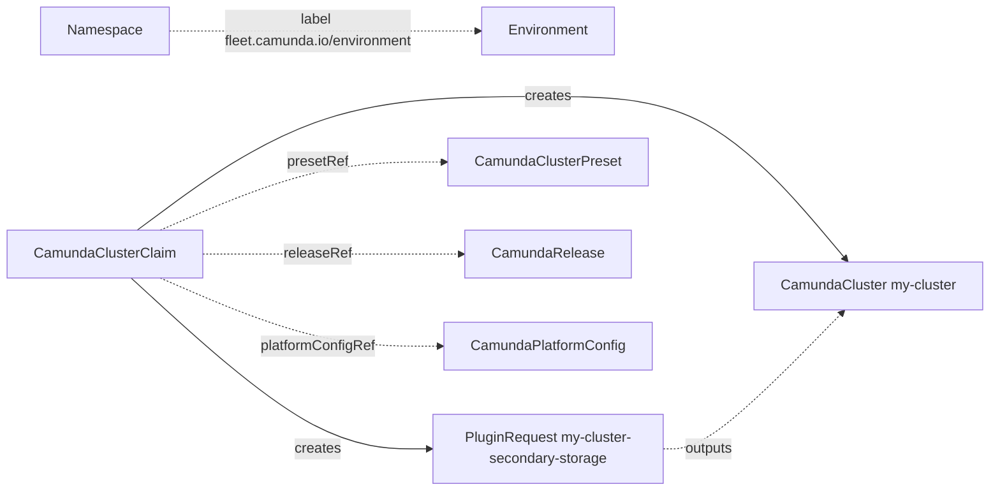

# CamundaClusterClaim

A `CamundaClusterClaim` asks for one Camunda cluster. It names a preset, a release, and one option for each section of the create flow, for example the secondary storage or the backup storage. The [fleet manager](../fleet-manager/install.md) writes claims, and you can also apply one with `kubectl`. The operator creates a [PluginRequest](pluginrequest.md) for each option and a [CamundaCluster](camundacluster.md) with the name of the claim. The [Environment](environment.md) of the namespace sets what the claim can use.

!!! note
    `fleet.camunda.io/v1alpha1` is an alpha API. Its fields can change in a later release. In this release, the operator does not act on `spec.attachments` of a claim yet.

The smallest claim:

```yaml
apiVersion: fleet.camunda.io/v1alpha1
kind: CamundaClusterClaim
metadata:
  name: my-cluster
  namespace: my-cluster-ns
spec:
  presetRef: small
  platformConfigRef: my-platform-config
  plugins:
    - section: secondary-storage
      registration: existing-secondary-storage
      parameters:
        name: my-storage-config
```

The claim can set the parameter `name` only when its policy makes `name` claim-editable. See [Environment and policy](#environment-and-policy). The [Claims guide](../guides/claims.md) creates this claim from the start.



## Environment and policy

A claim follows the `Environment` that the label `fleet.camunda.io/environment` of its namespace names:

```yaml
apiVersion: v1
kind: Namespace
metadata:
  name: my-cluster-ns
  labels:
    fleet.camunda.io/environment: production
```

When no `Environment` exists in the Kubernetes cluster, a namespace without the label is valid too. The registrations then give the policy. A claim can select each registration of a section. It can change only the parameters in `claimEditable` of the registration. When at least one `Environment` exists, a claim in a namespace without the label is refused with `NoEnvironment`.

On its first check, the claim records the policy of its `Environment` in `status.resolvedPolicy`, and the name of the `Environment` in `status.environment`. The policy holds the allowed registrations of each section, the parameter values, the claim-editable parameters, and the deletion default. A later change of `spec.sections`, `spec.parameters`, or `spec.deletionPolicy` of the `Environment` does not change the claim. The claim checks a new preset or release against the current `spec.presets.camundaCluster` and `spec.releases.allowed` of the `Environment`. A preset or release that the cluster already uses stays allowed when the `Environment` drops it. Other changes of such a claim, such as a suspend or a parameter, still apply. A change to a value that the `Environment` does not list gives `Ready` `False` with reason `NotAllowed`. The requests and the cluster then stay as they are.

A section of the policy that does not apply to a cluster claim, such as `management-database`, is never required for a cluster. A claim that selects an option in such a section is refused with `NotAllowed`. The [PluginSection](pluginsection.md#claim-kinds) page says what `appliesTo` does.

`spec.releaseRef` and `spec.platformConfigRef` are optional. Without them, the cluster gets `spec.releases.default` and `spec.platformConfigRef` of the `Environment`. A later change of that default moves the cluster to the new release.

## Plugin requests

The claim creates one `PluginRequest` for each item of `spec.plugins`. In a section that takes one option, the name of the request is `<claim>-<section>`. The claim `my-cluster` that selects an option of `secondary-storage` gets the request `my-cluster-secondary-storage`. In a section that takes many options, the name is `<claim>-<section>-<registration>`, so each option gets its own request. A name longer than 63 characters is cut to at most 54 characters. Then `-` and 8 characters of a hash of the full name follow. `status.requests` shows the name of each request. Each request carries the labels `plugins.camunda.io/section`, `plugins.camunda.io/registration`, and `fleet.camunda.io/claim`. To list the requests of a claim:

```bash
kubectl get pluginrequests -n my-cluster-ns -l fleet.camunda.io/claim=my-cluster
```

The plugin of each request gives its resources to a ServiceAccount of the cluster, in `spec.target.serviceAccountName`. The request of `connectors-permissions` names `<claim>-connectors`, the ServiceAccount of the Connectors. Every other request names `<claim>-camunda`. The request of `cloud-identity` also lists the ServiceAccount of the built-in storage in `spec.target.additionalServiceAccounts`:

| Option of `secondary-storage` | Additional ServiceAccount |
| --- | --- |
| `elasticsearch` | `<claim>-es-es` |
| `database-server` | `<claim>-pg-postgres` |
| any other | none |

An option can read an output of another section, for example the key of `encryption-key`. Its request is created only after the request of that section reports its outputs. Until then, `RequestsReady` is `False` with reason `Blocked`, and the message names the section: `waiting for the outputs of encryption-key`. The requests that come after it in the order of the inputs also wait.

The request gets the parameters that the policy and the claim give. An option whose parameter schema declares `releaseRef` also gets the name of the release of the claim in that parameter. `spec.deletionPolicy` of each request is the policy of the claim, or the deletion default of `status.resolvedPolicy`, or `Delete`.

A request of the same name that another owner controls stays as it is. `RequestsReady` is then `False` with reason `Blocked`, and the message names the owner. A `CamundaManagementClusterClaim` with the same name in the same namespace is such an owner. Give one of the two claims another name.

## The cluster

The claim creates the `CamundaCluster` `<claim>` when every request whose section has a slot reports its outputs. A request of a section without a slot, such as `encryption-key`, does not hold the cluster back. The [PluginSection](pluginsection.md#core-sections) page lists the slot of each core section.

The cluster gets these fields from the claim:

| Field of the `CamundaCluster` | Value |
| --- | --- |
| `spec.presetRef` | `spec.presetRef` of the claim |
| `spec.releaseRef` | `spec.releaseRef` of the claim, or the default release of the `Environment` |
| `spec.platformConfigRef` | `spec.platformConfigRef` of the claim, or that of the `Environment` |
| `spec.suspend` | `spec.suspend` of the claim |
| `spec.serviceAccount.name` | `<claim>-camunda` |
| `spec.connectors.serviceAccount.name` | `<claim>-connectors` |
| every other field | `spec.cluster` of the claim |

The outputs of the requests fill these fields:

| Section | Output | Field of the `CamundaCluster` |
| --- | --- | --- |
| `cloud-identity` | `serviceAccountAnnotations` | `spec.serviceAccount.annotations` |
| `connectors-permissions` | `serviceAccountAnnotations` | `spec.connectors.serviceAccount.annotations` |
| `volume-encryption` | `storageClassName` | `spec.zeebe.storageClassName` |
| `backup-storage` | `objectStorageConfig` | `spec.backupStorageRef` |
| `secondary-storage` | `secondaryStorageConfig` | `spec.storageRef` |
| `access` | `externalUrl` | `spec.externalUrl` |

When a request loses an output after the cluster exists, the cluster keeps the last value of that field. The cluster carries the label `fleet.camunda.io/claim` and an owner reference to the claim. The claim sets only the fields above. A field that it does not set stays free for another writer.

A `CamundaCluster` needs `spec.storageRef`, so a claim without an option of `secondary-storage` gets no cluster. `ClusterReady` is then `False` with reason `Error`, and the message holds `spec.storageRef is required`.

A `CamundaCluster` of the same name that another owner controls stays as it is. `ClusterReady` is then `False` with reason `Blocked`, and the message names the owner.

## Suspend

Set `spec.suspend: true` to stop the cluster:

```yaml
apiVersion: fleet.camunda.io/v1alpha1
kind: CamundaClusterClaim
metadata:
  name: my-cluster
  namespace: my-cluster-ns
spec:
  suspend: true
  # ... the rest of your claim
```

The `CamundaCluster` `my-cluster` gets `spec.suspend: true`. It scales to zero and keeps its data, as [Suspend and pause](camundacluster.md#suspend-and-pause) describes. The plugin requests do not change. Remove `spec.suspend`, or set it to `false`, to start the cluster again.

## Downgrade

The operator refuses a move of a cluster to a lower version, as [A lower version is refused](camundacluster.md#a-lower-version-is-refused) describes. To downgrade on purpose, set `spec.releaseRef` to the older release and `spec.allowVersionDowngrade` to its version, in the same edit. The `Environment` must allow the older release:

```yaml
apiVersion: fleet.camunda.io/v1alpha1
kind: CamundaClusterClaim
metadata:
  name: my-cluster
  namespace: my-cluster-ns
spec:
  releaseRef: camunda-8-9-3
  allowVersionDowngrade: "8.9.3"
  # ... the rest of your claim
```

The `CamundaCluster` then gets the annotation `camunda.io/allow-version-downgrade: "8.9.3"`, see [Downgrade on purpose](camundacluster.md#downgrade-on-purpose). The cluster carries the annotation until it runs that version. Clear `spec.allowVersionDowngrade` after that.

The annotation names only the version of the release of the claim. When `spec.allowVersionDowngrade` names another version, the cluster gets no annotation until `spec.releaseRef` names a release of that version. The cluster stays on the version of its release. While the claim is suspended, the annotation does not change, and a downgrade waits until the claim starts the cluster again.

## Deletion

`spec.deletionPolicy` says what the plugins do with the resources that they created for the claim, such as buckets, keys, roles, and routes. `Delete` deletes them. `Orphan` keeps them. The [PluginRequest](pluginrequest.md#deletion) page says what each policy keeps.

```yaml
apiVersion: fleet.camunda.io/v1alpha1
kind: CamundaClusterClaim
metadata:
  name: my-cluster
  namespace: my-cluster-ns
spec:
  deletionPolicy: Orphan
  # ... the rest of your claim
```

Without `spec.deletionPolicy`, the claim uses `status.resolvedPolicy.deletionPolicy`. This is the default of the `Environment` at the time that the claim was created, as [Environment and policy](#environment-and-policy) describes. A later change of the `Environment` does not change it. A claim without this value uses `Delete`.

The policy applies to the plugin requests only. The claim always deletes the `CamundaCluster` `<claim>`. It also deletes the `CamundaOptimize` `<claim>-optimize` and the `BackupSchedule` `<claim>-backups`. The `CamundaCluster` keeps or deletes its broker volumes by its own retention policy, as [Storage](camundacluster.md#storage) describes. The claim deletes an object only when the object has an owner reference with `controller: true` to the claim. An object of one of these names that you created yourself stays.

When the policy is `Orphan` and a selected registration does not list `Orphan` in `spec.deletionPolicies`, the claim deletes nothing. `Ready` is `False` with reason `NotAllowed`, and the message names each such registration. The selections of a claim do not change after creation. To continue the deletion, set `spec.deletionPolicy: Delete`. The plugins then delete the resources of the claim.

The claim stays until each plugin deleted or kept the resources of its request, by the policy. While the claim waits, `Ready` is `False` with reason `Deleting`, and the message names each object that is still there. See [Status](#status).

To change the policy of a claim that you delete, change `spec.deletionPolicy` first. Delete the claim after that. When a GitOps tool applies your claims, commit the change of the policy first. Before you remove the claim in a later commit, make sure that the claim shows the new policy:

```bash
kubectl get camundaclusterclaim my-cluster -n my-cluster-ns -o jsonpath='{.spec.deletionPolicy}'
```

## Status

`Ready` is `False` with a reason of the check of the claim when that check fails. The claim then creates and changes nothing:

| Reason | Meaning | What to do |
| --- | --- | --- |
| `NoEnvironment` | The namespace has no label `fleet.camunda.io/environment`, and an `Environment` exists. | Label the namespace. |
| `UnknownEnvironment` | The label names no `Environment`. | Create the `Environment`, or fix the label. |
| `InvalidReference` | The preset, the release, the platform config, a section, or a registration does not exist. The message names each one. | Create the object, or fix the name. |
| `NotAllowed` | The `Environment` does not allow the preset, the release, or a registration, or a required section has no option. A parameter is not claim-editable, or it is not a JSON object. A selected section does not apply to a cluster claim. A selected registration does not serve its section. The deletion policy of the claim, or the default of the `Environment`, is `Orphan`, and a selected registration does not list `Orphan` in `spec.deletionPolicies`. The claim selects two options of a section that takes one, or two selections get the same request name. The message names the value. | Pick an allowed value, or change the `Environment`. Select one option of a section that takes one. For `Orphan`, set `spec.deletionPolicy: Delete`, or pick a registration that supports `Orphan`. |
| `SlotConflict` | `spec.cluster` sets a field that a selected section fills, for example `externalUrl` with an option of `access`. | Remove the field from `spec.cluster`. |
| `MissingInput` | An option needs an output of a section in which the claim selects nothing. | Select an option of that section. |
| `WiringCycle` | The options read the outputs of each other in a cycle. The message names the sections. | Pick other options. |

You do not need to edit the claim after you correct the cause. The claim checks itself again when the namespace, the `Environment`, the preset, the release, the platform config, a section, or a registration changes.

When the check passes, `Ready` follows two conditions:

| Type | Reason | Meaning | What to do |
| --- | --- | --- | --- |
| `RequestsReady` | `OperationPending` | A plugin has not reported the outputs of its request. The message names the section. | Read the status of the request with `kubectl get pluginrequest <name> -o yaml`, with the name from `status.requests`. |
| `RequestsReady` | `Blocked` | A request waits for the outputs of another section, or another owner controls it. The message says which. | Wait, or rename one of the two claims. |
| `RequestsReady` | `Healthy` | Every request with a slot reports its outputs. | Nothing. |
| `ClusterReady` | `PrerequisiteNotMet` | The cluster waits for `RequestsReady`. The message holds the message of `RequestsReady`. | See `RequestsReady`. |
| `ClusterReady` | `Creating`, `Updating`, `Failing`, `Degraded`, `Down` | The `CamundaCluster` is not ready. The message holds its `Ready` reason and message, as `<Reason>: <Message>`. | See [CamundaCluster](camundacluster.md#status). |
| `ClusterReady` | `Blocked` | Another owner controls a `CamundaCluster` of this name, or an output came in after the check of the claim. The message says which. | For another owner, delete that cluster, or rename the claim. For an output, wait. |
| `ClusterReady` | `Error` | The API server refused the `CamundaCluster`. The message holds its answer. | Correct the claim. |
| `ClusterReady` | `Healthy` | The `CamundaCluster` is ready. | Nothing. |

`Ready` is `True` only when both are `True`. Otherwise, it takes the reason of the condition that blocks it, and its message starts with `requests:` or `cluster:`. A claim that waits for an output reports `PrerequisiteNotMet`:

```yaml
status:
  observedGeneration: 1
  environment: production
  conditions:
    - type: RequestsReady
      status: "False"
      reason: Blocked
      message: waiting for the outputs of encryption-key
      observedGeneration: 1
    - type: ClusterReady
      status: "False"
      reason: PrerequisiteNotMet
      message: 'Prerequisite not met: waiting for condition "RequestsReady" to become True (currently False: waiting for the outputs of encryption-key)'
      observedGeneration: 1
    - type: Ready
      status: "False"
      reason: PrerequisiteNotMet
      message: 'cluster: Prerequisite not met: waiting for condition "RequestsReady" to become True (currently False: waiting for the outputs of encryption-key)'
      observedGeneration: 1
  requests:
    - name: my-cluster-secondary-storage
      section: secondary-storage
      registration: existing-secondary-storage
      outputsReady: "True"
      ready: "True"
    - name: my-cluster-encryption-key
      section: encryption-key
      registration: aws-kms-key
    - name: my-cluster-volume-encryption
      section: volume-encryption
      registration: aws-encrypted-volumes
  resolvedPolicy:
    deletionPolicy: Delete
    sections:
      secondary-storage:
        allowed:
          - existing-secondary-storage
```

While the claim is deleted, `Ready` reports the deletion. The other conditions keep their last value:

| Type | Reason | Meaning | What to do |
| --- | --- | --- | --- |
| `Ready` | `Deleting` | The claim is deleted and waits for the objects that the message names. | Read the status of the request with `kubectl get pluginrequest <name> -o yaml`, with the name from the message. Then read the logs of the plugin that serves it. |
| `Ready` | `NotAllowed` | The deletion policy is `Orphan`, and a selected registration does not list `Orphan` in `spec.deletionPolicies`. The claim deletes nothing. The message names each such registration. | Set `spec.deletionPolicy: Delete`. The plugins then delete the resources of the claim. |

```yaml
status:
  conditions:
    - type: Ready
      status: "False"
      reason: Deleting
      message: 'The claim is deleted after these objects are gone: PluginRequest my-cluster-backup-storage'
      observedGeneration: 2
```

`status.requests` lists one item for each option, in the order of `spec.plugins`, with the status of the `OutputsReady` and `Ready` conditions of its request. `status.cluster.name` names the `CamundaCluster` once the claim controls it. A cluster of the same name that another owner controls is not named there.

`kubectl get camundaclusterclaims` shows `Ready`, the reason, the cluster, and the age. `kubectl get camundaclusterclaims -o wide` adds the preset, the release, and the environment.

## Fields

The [API reference](api-reference.md#camundaclusterclaim) lists every field of `CamundaClusterClaim`, with its type, whether it is required, its default, and its validation.

## Validation rules

The API server refuses a claim when:

- The name is not a DNS-1035 label of at most 40 characters: `metadata.name must be a DNS-1035 label of at most 40 characters, because the claim adds a suffix to it in the names of the resources that it writes`.
- An update adds, removes, or changes a section or a registration of `spec.plugins`: `sections and their registrations are fixed after creation`. Only the parameters of a selection can change.
- `spec.cluster` sets a field that the claim sets itself: `spec.cluster must not set presetRef, releaseRef, platformConfigRef, suspend, version, connectors.version, serviceAccount.name, connectors.serviceAccount.name, storageRef, or backupStorageRef: the claim, its release, the claim controller, or a selected section sets them`.
- `spec.attachments.optimize.importer.replicas` is more than 1: `importer.replicas must be 0 or 1: Optimize supports one active importer`.
- `spec.attachments.optimize.externalUrl` is not a valid URL for Optimize. The messages are the same as for `externalUrl` of a [CamundaOptimize](camundaoptimize.md).

## A production-shaped example

```yaml
apiVersion: fleet.camunda.io/v1alpha1
kind: CamundaClusterClaim
metadata:
  name: my-cluster
  namespace: my-cluster-ns
spec:
  presetRef: small
  releaseRef: camunda-8-9-0
  deletionPolicy: Orphan
  plugins:
    - section: secondary-storage
      registration: existing-secondary-storage
      parameters:
        name: my-storage-config
    - section: backup-storage
      registration: existing-object-storage
      parameters:
        name: my-backup-bucket
    - section: cloud-identity
      registration: aws-pod-identity
  cluster:
    zeebe:
      partitions: 3
      replicas: 3
```

## Related

- [Environment](environment.md): the policy of the claims of a namespace.
- [PluginRequest](pluginrequest.md): the request that the claim creates for each option.
- [PluginSection](pluginsection.md) and [PluginRegistration](pluginregistration.md): the sections and the options that a claim selects.
- [CamundaCluster](camundacluster.md): the cluster that the claim creates.
- [Claims guide](../guides/claims.md): create a cluster from a claim, step by step.
