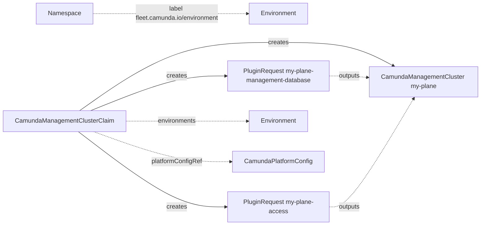

# CamundaManagementClusterClaim

A `CamundaManagementClusterClaim` asks for one management plane. It names the environments that the plane serves, the version of each component, and one option for the databases and for the access from outside. The [fleet manager](../fleet-manager/install.md) writes claims, and you can also apply one with `kubectl`. The operator creates a [PluginRequest](pluginrequest.md) for each option and a [CamundaManagementCluster](camundamanagementcluster.md) with the name of the claim. The [Environment](environment.md) of the namespace of the claim sets what the claim can use.

!!! note
    `fleet.camunda.io/v1alpha1` is an alpha API. Its fields can change in a later release.

The smallest claim:

```yaml
apiVersion: fleet.camunda.io/v1alpha1
kind: CamundaManagementClusterClaim
metadata:
  name: my-plane
  namespace: my-plane-ns
spec:
  environments:
    - production
  platformConfigRef: my-platform-config
  management:
    identityProvider:
      oidc: {}
    identity:
      externalUrl: https://plane.example.com/identity
      admin:
        claimName: groups
        claimValue: camunda-admins
  versions:
    identity: 8.9.10
  plugins:
    - section: management-database
      registration: existing-database-configs
      parameters:
        identity: my-identity-db
```

The claim can set the parameter `identity` only when the policy of its `Environment` lets a claim change it. See [Environment](environment.md). The [Claims guide](../guides/claims.md#create-a-management-plane-from-a-claim) creates a plane from a claim, step by step.



## Environment and policy

A plane claim follows the `Environment` of its own namespace, as a [CamundaClusterClaim](camundaclusterclaim.md#environment-and-policy) does. The label `fleet.camunda.io/environment` of the namespace names it. The claim records the policy of that `Environment` in `status.resolvedPolicy` on its first check. A later change of the `Environment` does not change the policy of the claim.

A section of the policy that does not apply to a plane claim, such as `secondary-storage`, is never required for a plane. A claim that selects an option in such a section is refused with `NotAllowed`. The [PluginSection](pluginsection.md#claim-kinds) page says what `appliesTo` does, and its [core sections](pluginsection.md#core-sections) list the claim kinds of each core section.

`spec.platformConfigRef` is optional. Without it, the plane gets `spec.platformConfigRef` of the `Environment`. When neither names a platform config, the claim is refused with `MissingInput`.

## Served environments

`spec.environments` names the environments whose clusters the plane serves. Each name must be an `Environment`, otherwise the claim is refused with `InvalidReference`. The plane gets one selector on the label `fleet.camunda.io/environment` of the namespaces:

```yaml
apiVersion: fleet.camunda.io/v1alpha1
kind: CamundaManagementClusterClaim
metadata:
  name: my-plane
  namespace: my-plane-ns
spec:
  environments:
    - production
    - staging
  # ... the rest of your claim
```

The `CamundaManagementCluster` `my-plane` then holds:

```yaml
spec:
  namespaceSelector:
    matchExpressions:
      - key: fleet.camunda.io/environment
        operator: In
        values:
          - production
          - staging
```

A change of `spec.environments` changes the selector. `spec.clusterSelector` of the claim selects the clusters in these namespaces, as on the [CamundaManagementCluster](camundamanagementcluster.md).

## Databases

The claim must select an option of the section `management-database`. Without it, the claim is refused with `MissingInput`. The request of that section gets the parameter `databases`. It lists the components of the plane that need a database:

| Claim | `databases` |
| --- | --- |
| `management.identityProvider.keycloak` set | `keycloak`, `identity` |
| `management.identityProvider.externalKeycloak` or `oidc` set | `identity` |
| `management.webModeler` set | adds `webModeler` |

The option writes one `DatabaseConfig` for each item, and the plane names them in `databaseConfigRef` of Keycloak, Management Identity, and Web Modeler. When you turn on Web Modeler after creation, the plane stays without Web Modeler until the option reports the new `DatabaseConfig`. Until then, `ManagementClusterReady` is `False` with reason `Blocked`, and the message is `waiting for the outputs of management-database`.

## Access

With an option of the section `access`, the plugin reports one host, and the plane gets five URLs on that host. For the host `plane.example.com`:

| Field of the `CamundaManagementCluster` | URL |
| --- | --- |
| `spec.identityProvider.keycloak.externalUrl` | `https://plane.example.com/auth` |
| `spec.identity.externalUrl` | `https://plane.example.com/identity` |
| `spec.console.externalUrl` | `https://plane.example.com/console` |
| `spec.webModeler.externalUrl` | `https://plane.example.com/modeler` |
| `spec.webModeler.websocketsExternalUrl` | `https://plane.example.com/modeler-ws` |

A URL is set only for a component that the plane runs. With an option of `access`, the claim must not set a URL in `spec.management`. Such a claim is refused with `SlotConflict`, and the message names the field.

Without an option of `access`, the claim sets each URL that the plane needs in `spec.management`. The plane needs the Identity URL, and the Keycloak URL in the `keycloak` mode. It also needs the Console URL while Console is set, and both Web Modeler URLs while Web Modeler is set. A claim that leaves one of them empty is refused with `MissingInput`, and the message names each missing field:

```yaml
apiVersion: fleet.camunda.io/v1alpha1
kind: CamundaManagementClusterClaim
metadata:
  name: my-plane
  namespace: my-plane-ns
spec:
  management:
    identity:
      externalUrl: https://plane.example.com/identity
      # ... the rest of identity
    console:
      externalUrl: https://plane.example.com/console
  # ... the rest of your claim
```

## Versions

`spec.versions` holds the version of each component: `identity`, `keycloak` in the `keycloak` mode, `console` while Console is set, and `webModeler` while Web Modeler is set. The plane gets them as written. The operator does not look them up. The fleet manager fills them from its images table.

## Identity mode

`spec.management.identityProvider` holds one of `keycloak`, `externalKeycloak`, or `oidc`. A change of the mode goes to the plane, and the `databases` parameter follows it. See [Change the identity provider](camundamanagementcluster.md#change-the-identity-provider) for what the plane does then.

## The plane

The claim creates the `CamundaManagementCluster` `<claim>` when the request of each option reports its outputs. The plane gets these fields from the claim:

| Field of the `CamundaManagementCluster` | Value |
| --- | --- |
| `spec.platformConfigRef` | `spec.platformConfigRef` of the claim, or that of the `Environment` |
| `spec.namespaceSelector` | `spec.environments`, see [Served environments](#served-environments) |
| `spec.clusterSelector`, `spec.suspend`, `spec.managementAuthConfigName` | the same fields of the claim |
| `spec.identityProvider`, `spec.identity`, `spec.console`, `spec.webModeler` | `spec.management` of the claim |
| every `version` | `spec.versions` of the claim |
| every `databaseConfigRef` | the outputs of `management-database` |
| every `externalUrl` | the outputs of `access`, or `spec.management` |

When a request loses an output after the plane exists, the plane keeps the last value of that field. The plane carries the label `fleet.camunda.io/claim` and an owner reference to the claim. A field that the claim does not set stays free for another writer. A `CamundaManagementCluster` of the same name that another owner controls stays as it is.

## Deletion

`spec.deletionPolicy` says what the plugins do with the resources that they created for the claim. `Delete` deletes them. `Orphan` keeps them. The policy goes to every request of the claim. The deletion of a `Database` keeps the data on its server, and the deletion of a `DatabaseServer` erases it. See [Database](database.md#deletion) and [DatabaseServer](databaseserver.md).

```yaml
apiVersion: fleet.camunda.io/v1alpha1
kind: CamundaManagementClusterClaim
metadata:
  name: my-plane
  namespace: my-plane-ns
spec:
  deletionPolicy: Orphan
  # ... the rest of your claim
```

Without `spec.deletionPolicy`, the claim uses the default that it recorded from its `Environment` at creation, or `Delete`. When the policy is `Orphan` and a selected registration does not list `Orphan` in `spec.deletionPolicies`, the claim is refused with `NotAllowed`, and it creates nothing. When you delete such a claim, it deletes nothing and stays, and `Ready` is `False` with reason `NotAllowed`. To continue the deletion, set `spec.deletionPolicy: Delete`.

The claim always deletes the `CamundaManagementCluster` `<claim>` first. Then it deletes the requests. The claim stays until each plugin deleted or kept the resources of its request. While the claim waits, `Ready` is `False` with reason `Deleting`, and the message names each object that is still there. Read it with `kubectl get camundamanagementclusterclaim my-plane -n my-plane-ns -o yaml`.

## Status

`Ready` is `False` with a reason of the check of the claim when that check fails. The claim then creates and changes nothing:

| Reason | Meaning | What to do |
| --- | --- | --- |
| `NoEnvironment` | The namespace has no label `fleet.camunda.io/environment`, and an `Environment` exists. | Label the namespace. |
| `UnknownEnvironment` | The label names no `Environment`. | Create the `Environment`, or fix the label. |
| `InvalidReference` | An entry of `spec.environments`, the platform config, a section, or a registration does not exist. The message names each one. | Create the object, or fix the name. |
| `NotAllowed` | The `Environment` does not allow a registration, or a required section has no option. A parameter is not claim-editable, or it is not a JSON object. A selected section does not apply to a plane claim. A selected registration does not serve its section. The deletion policy is `Orphan`, and a selected registration does not list `Orphan`. The message names the value. | Pick an allowed value, or change the `Environment`. For `Orphan`, set `spec.deletionPolicy: Delete`, or pick a registration that supports `Orphan`. |
| `SlotConflict` | `spec.management` sets a URL, and the claim selects an option of `access`. | Remove the URL from the claim. |
| `MissingInput` | The claim selects no option of `management-database`, no platform config applies, or the claim selects no option of `access` and leaves a URL empty. An option can also need an output of a section without an option. The message says which. | Select the option, set `spec.platformConfigRef`, or set the URLs that the message names. |
| `WiringCycle` | The options read the outputs of each other in a cycle. The message names the sections. | Pick other options. |

A refused claim keeps the requests and the plane that it created before. The claim checks itself again when the namespace, an `Environment`, the platform config, a section, or a registration changes.

When the check passes, `Ready` follows two conditions:

| Type | Reason | Meaning | What to do |
| --- | --- | --- | --- |
| `RequestsReady` | `OperationPending` | A plugin has not reported the outputs of its request. The message names the section. | Read the status of the request with `kubectl get pluginrequest <name> -o yaml`, with the name from `status.requests`. |
| `RequestsReady` | `Blocked` | A request waits for the outputs of another section, or another owner controls it. The message says which. | Wait, or rename one of the two claims. |
| `RequestsReady` | `Healthy` | The request of each option reports its outputs. | Nothing. |
| `ManagementClusterReady` | `PrerequisiteNotMet` | The plane waits for `RequestsReady`. | See `RequestsReady`. |
| `ManagementClusterReady` | `Creating`, `Updating`, `Failing`, `Degraded`, `Down` | The `CamundaManagementCluster` is not ready. The message holds its `Ready` reason and message, as `<Reason>: <Message>`. | See [CamundaManagementCluster](camundamanagementcluster.md#status). |
| `ManagementClusterReady` | `Blocked` | A component that you turned on waits for its database, or another owner controls a plane of this name. The message says which. | For a database, wait. For another owner, delete that plane, or rename the claim. |
| `ManagementClusterReady` | `Error` | The API server refused the `CamundaManagementCluster`. The message holds its answer. | Correct the claim. |
| `ManagementClusterReady` | `Healthy` | The plane is ready. | Nothing. |

`Ready` is `True` only when both are `True`. Otherwise, it takes the reason of the condition that blocks it, and its message starts with `requests:` or `managementcluster:`:

```yaml
status:
  observedGeneration: 1
  environment: production
  conditions:
    - type: RequestsReady
      status: "True"
      reason: Healthy
      observedGeneration: 1
    - type: ManagementClusterReady
      status: "False"
      reason: Creating
      message: 'Creating: Management Identity is starting'
      observedGeneration: 1
    - type: Ready
      status: "False"
      reason: Creating
      message: 'managementcluster: Creating: Management Identity is starting'
      observedGeneration: 1
  managementCluster:
    name: my-plane
  requests:
    - name: my-plane-management-database
      section: management-database
      registration: management-database-server
      outputsReady: "True"
      ready: "True"
```

While the claim is deleted, `Ready` is `False` with reason `Deleting`, or with reason `NotAllowed` for an `Orphan` policy that a registration does not support. See [Deletion](#deletion).

```yaml
status:
  conditions:
    - type: Ready
      status: "False"
      reason: Deleting
      message: 'The claim is deleted after these objects are gone: PluginRequest my-plane-access'
      observedGeneration: 2
```

`status.requests` lists one item for each option, in the order of `spec.plugins`. `status.managementCluster.name` names the `CamundaManagementCluster` once the claim controls it.

`kubectl get camundamanagementclusterclaims` shows `Ready`, the reason, the plane, and the age. `-o wide` adds the environments.

## Fields

The [API reference](api-reference.md#camundamanagementclusterclaim) lists every field of `CamundaManagementClusterClaim`, with its type, whether it is required, its default, and its validation.

## Validation rules

The API server refuses a claim when:

- The name is not a DNS-1035 label of at most 40 characters: `metadata.name must be a DNS-1035 label of at most 40 characters, because the claim adds a suffix to it in the names of the resources that it writes`.
- An update adds, removes, or changes a section or a registration of `spec.plugins`: `sections and their registrations are fixed after creation`.
- A component has no version: `versions.keycloak is required with the keycloak identity provider`, `versions.console is required when management.console is set`, or `versions.webModeler is required when management.webModeler is set`.
- `spec.management` breaks a rule of the `CamundaManagementCluster`, for example `exactly one identity provider: keycloak, externalKeycloak, or oidc`.

## A production-shaped example

```yaml
apiVersion: fleet.camunda.io/v1alpha1
kind: CamundaManagementClusterClaim
metadata:
  name: my-plane
  namespace: my-plane-ns
spec:
  environments:
    - production
    - staging
  clusterSelector: {}
  deletionPolicy: Orphan
  management:
    identityProvider:
      keycloak:
        replicas: 2
    identity:
      admin:
        username: admin
        email: admin@example.com
    console: {}
    webModeler:
      mail:
        smtpHost: smtp.example.com
        fromAddress: modeler@example.com
  versions:
    identity: 8.9.10
    keycloak: 26.3.1
    console: 8.9.122
    webModeler: 8.9.11
  plugins:
    - section: management-database
      registration: management-database-server
      parameters:
        preset: small
    - section: access
      registration: my-access-plugin
```

## Related

- [Environment](environment.md): the policy of the claims of a namespace.
- [PluginRequest](pluginrequest.md): the request that the claim creates for each option.
- [CamundaManagementCluster](camundamanagementcluster.md): the plane that the claim creates.
- [CamundaClusterClaim](camundaclusterclaim.md): the claim of a cluster.
- [Claims guide](../guides/claims.md): create a plane from a claim, step by step.
