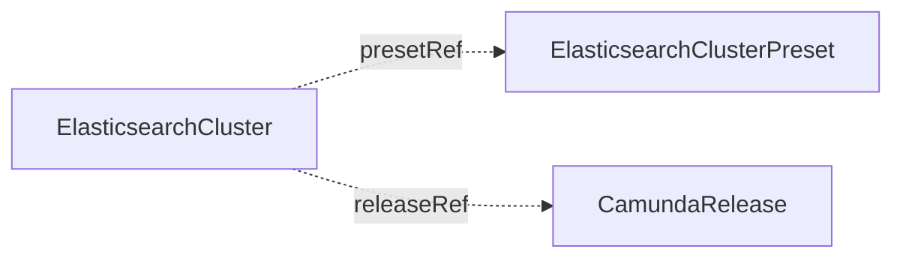

# ElasticsearchClusterPreset

`ElasticsearchClusterPreset` is a cluster-scoped baseline configuration for `ElasticsearchCluster` resources. You create it, or another tool creates it for you.

A preset holds one Elasticsearch sizing as data: node count, resources, storage, scheduling, and more. Each `ElasticsearchCluster` that references it stays small and consistent. A platform team can publish a set of presets, for example `small`, `standard`, and `large`, and each team picks one. What runs on that shape, the Elasticsearch version, lives in a [CamundaRelease](camundarelease.md), so a version roll never edits a preset.

A preset creates nothing and reports no status. An `ElasticsearchCluster` uses it through `spec.presetRef`.

The smallest preset sets a node count and a volume size:

```yaml
apiVersion: core.camunda.io/v1
kind: ElasticsearchClusterPreset
metadata:
  name: standard
spec:
  cluster:
    replicas: 3
    storageSize: "64Gi"
```



## Merge rules

`spec.cluster` of the preset is the baseline. The [CamundaRelease](camundarelease.md) of `releaseRef` merges over it, and the cluster spec merges over both. The release supplies the version only. A field set on the `ElasticsearchCluster` replaces the value of the layer below for that field. A field left unset on the cluster comes from the layer below. Each field merges as the table says.

| Field | Merge behavior |
| --- | --- |
| `replicas`, `storageSize`, `storageClassName`, `snapshotStorageRef` | The cluster value replaces the preset value. An unset cluster field inherits the preset value. |
| `resources`, `serviceAccount`, `scheduling`, `monitoring`, `persistentVolumeClaimRetentionPolicy` | Replaced as a whole block, never merged field by field. A cluster that sets its own `scheduling` block drops every scheduling rule of the preset. |
| `secureSettings`, `extraEnv`, `extraEnvFrom`, `podLabels`, `podAnnotations` | Replaced as a whole list or map, never merged entry by entry. A cluster that sets one pod label drops every pod label of the preset. An empty list or map (for example `extraEnv: []` or `podLabels: {}`) counts as unset and keeps the preset value. |
| `presetRef`, `releaseRef`, `secondaryStorageConfig`, `suspend` | Instance-bound. They always come from the cluster and are rejected in a preset. |
| `version` | Not part of a preset. It comes from `spec.elasticsearch.version` of the release, and a cluster value replaces it. A preset that sets it is rejected. |

To remove a list or a map that the preset sets, set the value that you want on the cluster. Or reference a preset without that field.

## Fleet settings

A preset can set `snapshotStorageRef`, `serviceAccount`, `secureSettings`, and `monitoring`. So one preset can put every cluster that references it on one snapshot bucket. Each cluster writes its snapshots under its own path in that bucket. The preset can also give each cluster its `<name>-es` ServiceAccount and turn on metrics scraping.

```yaml
apiVersion: core.camunda.io/v1
kind: ElasticsearchClusterPreset
metadata:
  name: standard
spec:
  cluster:
    replicas: 3
    storageSize: "64Gi"
    snapshotStorageRef: "my-backup-bucket"
    monitoring:
      serviceMonitor:
        enabled: true
```

`snapshotStorageRef` names an `ObjectStorageConfig` in the namespace of each cluster. Each namespace that uses the preset needs an `ObjectStorageConfig` of that name.

## Changes

An edit of a preset reaches every `ElasticsearchCluster` that references it. A lower `storageSize` in the preset does not shrink a running cluster. That cluster keeps its current size and records a Warning event with reason `StorageShrinkIgnored`. A new cluster uses the new baseline.

A change of `storageClassName` reaches only the clusters that do not have an ECK resource yet. A suspended cluster takes it for its new volumes when it resumes. A cluster with an ECK resource keeps its class and records the Warning event `StorageClassChangeIgnored`. Volumes that a suspension or `whenDeleted: Retain` kept keep their class.

## Deletion

Deleting a preset removes no cluster. Each `ElasticsearchCluster` that references it reports `Ready` `False` with reason `InvalidReference`.

## Status

A preset has no status. It reports no conditions and no `status.observedGeneration`. A problem with a preset shows on the `Ready` condition of the `ElasticsearchCluster` that references it. Examples are a `presetRef` that names no preset, or a merge that lacks a required field.

## Fields

The [API reference](api-reference.md#elasticsearchclusterpreset) lists every field of `ElasticsearchClusterPreset`, with its type, whether it is required, its default, and its validation.

`spec.cluster` has the same type as the spec of `ElasticsearchCluster`. The fields `presetRef`, `releaseRef`, `secondaryStorageConfig`, and `suspend` belong to one cluster and must stay unset in a preset. [Validation rules](#validation-rules) has the rule for `version`. Every other field is inheritable.

## Validation rules

- `spec.cluster` must not set `presetRef`, `releaseRef`, `secondaryStorageConfig`, or `suspend`. An empty `presetRef`, an empty `releaseRef`, and `suspend: false` count as unset, so templated YAML that renders zero values still applies. An empty `secondaryStorageConfig` is rejected by the name pattern. Omit the field instead.
- `version` is rejected in `spec.cluster` with `version belongs to a CamundaRelease and must not be set in a preset`. Move the version to a [CamundaRelease](camundarelease.md), and point every cluster at it with `releaseRef`. An empty `version` is rejected by the three-segment pattern. Omit the field instead.
- The no-shrink rule of `ElasticsearchCluster` for `storageSize` does not bind a preset. You can lower the baseline at any time.
- Whether the merged configuration is complete is checked on the `ElasticsearchCluster`, not on the preset.
- Every other rule of the `ElasticsearchCluster` schema applies to `spec.cluster`: `replicas` at least 1, and valid resource names.

## A production-shaped example

```yaml
apiVersion: core.camunda.io/v1
kind: ElasticsearchClusterPreset
metadata:
  name: large
spec:
  cluster:
    replicas: 5
    resources:
      requests: { cpu: "4", memory: "8Gi" }
      limits: { memory: "8Gi" }
    storageSize: "256Gi"
    storageClassName: "ssd"
    snapshotStorageRef: "my-backup-bucket"
    scheduling:
      tolerations:
        - key: dedicated
          operator: Equal
          value: elasticsearch
          effect: NoSchedule
    monitoring:
      serviceMonitor:
        enabled: true
        labels:
          release: prometheus
    persistentVolumeClaimRetentionPolicy:
      whenDeleted: Retain
```

## Related

- [ElasticsearchCluster](elasticsearchcluster.md): references a preset through `spec.presetRef` and inherits `spec.cluster`.
- [CamundaRelease](camundarelease.md): the Elasticsearch version that runs on this shape. It merges between the preset and the cluster.
- [ObjectStorageConfig](objectstorageconfig.md): the snapshot bucket that `spec.cluster.snapshotStorageRef` names.
- [Secondary storage guide](../guides/secondary-storage.md): how to choose and connect secondary storage.
- [Getting started](../getting-started.md): the first cluster, end to end.
