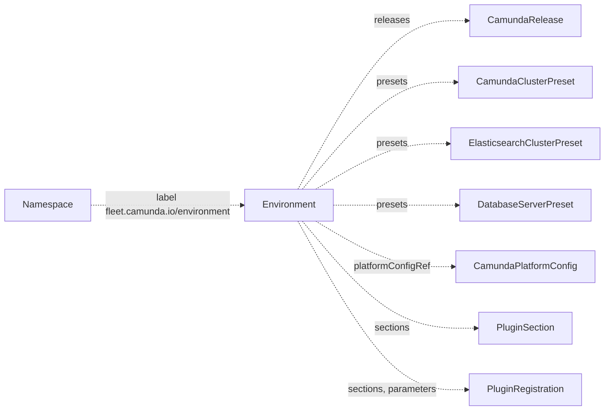

# Environment

An `Environment` sets the policy for the claims in its namespaces. A claim is a request for a Camunda cluster or a management plane, in one namespace. The [fleet manager](../fleet-manager/install.md) is the web app that creates claims. A namespace belongs to the `Environment` that its label `fleet.camunda.io/environment` names. An `Environment` is cluster-scoped.

The policy names the releases and the presets that a claim can use. It also names the plugin options of each `PluginSection` of the create flow, for example "Backup storage". Each option is a `PluginRegistration`. The policy sets the parameter values of each option and the deletion default.

!!! note
    `fleet.camunda.io/v1alpha1` is an alpha API. Its fields can change in a later release. In this release, the operator reports the status of an environment. It does not create anything from a claim yet.

The smallest manifest:

```yaml
apiVersion: fleet.camunda.io/v1alpha1
kind: Environment
metadata:
  name: production
spec:
  releases:
    allowed:
      - camunda-8-9-0
    default: camunda-8-9-0
```



## Namespaces

To put a namespace in an environment, give the namespace the label `fleet.camunda.io/environment` with the name of the environment:

```yaml
apiVersion: v1
kind: Namespace
metadata:
  name: my-cluster-ns
  labels:
    fleet.camunda.io/environment: production
```

`status.namespaces` is the number of namespaces that carry the label with the name of the environment. It is `0` when no namespace carries it. To move a namespace to another environment, change the value of the label. A namespace without the label belongs to no environment.

## References

The spec names cluster-scoped objects by their names:

| Field | Kind |
| --- | --- |
| `spec.platformConfigRef` | `CamundaPlatformConfig` |
| `spec.presets.camundaCluster` | `CamundaClusterPreset` |
| `spec.presets.elasticsearchCluster` | `ElasticsearchClusterPreset` |
| `spec.presets.databaseServer` | `DatabaseServerPreset` |
| `spec.releases.allowed`, `spec.releases.default` | `CamundaRelease` |
| the keys of `spec.sections` | `PluginSection` |
| `spec.sections.<section>.allowed`, `spec.sections.<section>.default`, the keys of `spec.parameters` | `PluginRegistration` |

When one of these objects does not exist, `Ready` is `False` with reason `InvalidReference`. The message names the kind and the name of each missing object:

```yaml
status:
  observedGeneration: 2
  namespaces: 3
  conditions:
    - type: Ready
      status: "False"
      reason: InvalidReference
      message: "The spec names objects that do not exist: CamundaRelease camunda-8-10-0, PluginSection backup-storage"
      observedGeneration: 2
      lastTransitionTime: "2026-10-15T09:12:44Z"
```

To correct it, create each missing object, or remove its name from the spec. You do not need to edit the environment after you create an object. `Ready` changes to `True` when the last missing object exists. When you delete an object that the spec names, `Ready` changes to `False` again.

## Policy

`spec.sections` holds the policy of each `PluginSection`, by section name. A claim can select only a registration in `allowed`. The create flow of the fleet manager preselects `default`. The empty option selects no registration of the section. `required: true` makes a claim select a registration, and the fleet manager then hides the empty option. A section that is not in `spec.sections` offers only the empty option:

```yaml
apiVersion: fleet.camunda.io/v1alpha1
kind: Environment
metadata:
  name: production
spec:
  sections:
    backup-storage:
      required: true
      default: s3-backups
      allowed:
        - s3-backups
  # ... the rest of your environment
```

`spec.parameters` holds the policy of the parameters of each `PluginRegistration`, by registration name and then by parameter name. `value` replaces the value that the registration gives. `claimEditable: true` lets a claim change the parameter. `allowed` limits a claim to a list of choices, and a claim cannot pick a name outside the list. Each choice has a `name` that the claim stores, a `label` that the fleet manager shows, and a `value` that the plugin gets. A parameter without a policy keeps the value of its registration, and a claim cannot change it. In the example below, `aws-connectors` is the name of a registration, and `policies` is the name of one of its parameters:

```yaml
apiVersion: fleet.camunda.io/v1alpha1
kind: Environment
metadata:
  name: production
spec:
  parameters:
    aws-connectors:
      policies:
        claimEditable: true
        allowed:
          - name: sqs
            label: SQS access
            value: arn:aws:iam::aws:policy/AmazonSQSFullAccess
  # ... the rest of your environment
```

`spec.deletionPolicy` is the deletion policy of a claim that sets none itself. `Delete` deletes the resources that the plugins created for the claim when you delete the claim. `Orphan` keeps them. The default is `Delete`.

`spec.namespaceCreation` lets the create flow of the fleet manager create a namespace in the environment. `allowed: true` turns it on. `labels` are fixed labels of each new namespace. `requiredLabelKeys` are label keys that the create flow asks a value for. The create flow always sets the label `fleet.camunda.io/environment` on the new namespace:

```yaml
apiVersion: fleet.camunda.io/v1alpha1
kind: Environment
metadata:
  name: production
spec:
  namespaceCreation:
    allowed: true
    labels:
      owner: platform
    requiredLabelKeys:
      - team
  # ... the rest of your environment
```

A change of `sections`, `parameters`, or `deletionPolicy` applies to new claims only. An existing claim keeps the policy that it recorded at creation. The releases and the presets are different. A new claim, and a release or preset change of an existing claim, are checked against the current lists.

## Status

| Type | Reason | Meaning | What to do |
| --- | --- | --- | --- |
| `Ready` | `Healthy` | Every object that the spec names exists. | Nothing. |
| `Ready` | `InvalidReference` | The spec names an object that does not exist. The message names the kind and the name of each one. | Create the object, or remove its name from the spec. |

`status.namespaces` is the number of namespaces with the label of the environment. `status.observedGeneration` is the last generation of the spec that the status describes.

`kubectl get environments` shows `Ready`, the reason, the number of namespaces, and the age. `kubectl get environments -o wide` adds the display name.

## Fields

The [API reference](api-reference.md#environment) lists every field of `Environment`, with its type, whether it is required, its default, and its validation.

## Validation rules

The API server refuses an environment when:

- The name is longer than 63 characters: `metadata.name must be at most 63 characters, because it is used as a label value`.
- `sections` has an empty key: `sections cannot have an empty section name`.
- `parameters` has an empty key: `parameters cannot have an empty registration name`.
- A name in `presets` or in `releases.allowed` is empty.
- `releases.default` is set and is not in `releases.allowed`: `releases.default must be one of releases.allowed`.
- The `default` of a section policy is set and is not in its `allowed`: `default must be one of allowed`.
- A section policy has `required: true` and an empty `allowed`: `required needs at least one registration in allowed`.
- A parameter policy has `allowed` without `claimEditable: true`: `allowed needs claimEditable: true`.
- `namespaceCreation.labels` or `namespaceCreation.requiredLabelKeys` holds `fleet.camunda.io/environment`: `the environment label is set by the app`.
- A key of `namespaceCreation.labels` or of `namespaceCreation.requiredLabelKeys` is not a valid label key, or a label value is not a valid label value.
- Two choices of a parameter policy have the same `name`.

The API reference gives the bounds of each field, for example the length of `displayName` and the number of entries in `sections`.

## A production-shaped example

```yaml
apiVersion: fleet.camunda.io/v1alpha1
kind: Environment
metadata:
  name: production
spec:
  displayName: Production
  color: "#2E7D32"
  platformConfigRef: my-platform-config
  presets:
    camundaCluster:
      - small
      - large
  releases:
    allowed:
      - camunda-8-9-0
    default: camunda-8-9-0
  sections:
    backup-storage:
      required: true
      default: s3-backups
      allowed:
        - s3-backups
  parameters:
    aws-connectors:
      policies:
        claimEditable: true
        allowed:
          - name: sqs
            label: SQS access
            value: arn:aws:iam::aws:policy/AmazonSQSFullAccess
  deletionPolicy: Delete
  namespaceCreation:
    allowed: true
    labels:
      owner: platform
    requiredLabelKeys:
      - team
```

## Related

- [CamundaRelease](camundarelease.md): named in `spec.releases`.
- [CamundaClusterPreset](camundaclusterpreset.md), [ElasticsearchClusterPreset](elasticsearchclusterpreset.md), [DatabaseServerPreset](databaseserverpreset.md): named in `spec.presets`.
- [CamundaPlatformConfig](camundaplatformconfig.md): named in `spec.platformConfigRef`.
- [PluginSection](pluginsection.md): named by the keys of `spec.sections`.
- [PluginRegistration](pluginregistration.md): named by the keys of `spec.parameters`, and in the `allowed` and `default` of each section.
- [API reference](api-reference.md#environment): every type and field of `fleet.camunda.io/v1alpha1`.
