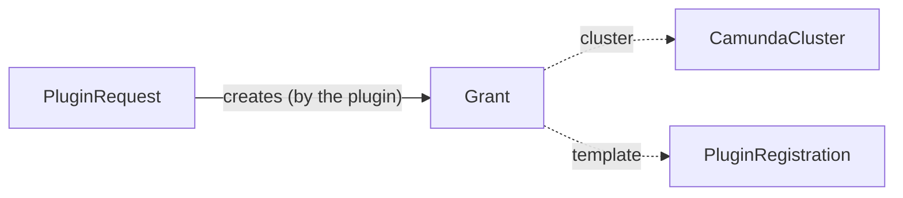

# Grant

A `Grant` asks the cloud identity of a cluster for one permission, on behalf of a [PluginRequest](pluginrequest.md). A plugin writes one grant for each grant template of its [PluginRegistration](pluginregistration.md#grant-templates), for example the permission to read and write a backup bucket. The identity extension of the cluster applies the permission and writes the status.

`Grant` is namespaced. It lives in the namespace of its request. It is an alpha API in the group `plugins.camunda.io/v1alpha1`, and its fields can change in a later release.

The smallest grant:

```yaml
apiVersion: plugins.camunda.io/v1alpha1
kind: Grant
metadata:
  name: orders-backup-storage-bucket-access
  namespace: my-cluster-ns
  labels:
    plugins.camunda.io/registration: s3-backup-bucket
    plugins.camunda.io/request: orders-backup-storage
    plugins.camunda.io/cluster: orders
spec:
  cluster:
    name: orders
  template: bucket-access
  format: aws-iam-statement
  fragment:
    Effect: Allow
    Action: ["s3:GetObject", "s3:PutObject"]
    Resource: ["arn:aws:s3:::orders-backup-storage/*"]
```



## Labels

Each grant carries three labels that you can select on:

| Label | Value |
| --- | --- |
| `plugins.camunda.io/registration` | The name of the registration that holds the template. |
| `plugins.camunda.io/request` | The name of the request that the grant belongs to. |
| `plugins.camunda.io/cluster` | The name of the `CamundaCluster` whose identity gets the permission. |

To list the permissions of one cluster:

```bash
kubectl get grants -n my-cluster-ns -l plugins.camunda.io/cluster=orders
```

## Format

`spec.format` is the format of `spec.fragment`. The only format today is `aws-iam-statement`: one AWS IAM policy statement, as a JSON object.

## Status

| Type | Reason | Meaning | What to do |
| --- | --- | --- | --- |
| `Applied` | `Healthy` | The identity extension applied the fragment. | Nothing. |
| `Applied` | `OverCeiling` | The fragment asks for more than the ceiling of the identity extension allows. | Ask the admin of the identity extension to raise the ceiling, or change the parameters of the request. |
| `Applied` | `OverSizeLimit` | The fragment takes the policy of the identity over the size limit of the cloud. | Select fewer options that ask for permissions for this cluster. |
| `Applied` | `Rejected` | The identity extension or the cloud refused the fragment for another reason. The message says why. | Read the message. |
| `MatchesTemplate` | `Healthy` | The fragment matches its template in the registration. | Nothing. |
| `MatchesTemplate` | `TemplateChanged` | The fragment no longer matches its template in the registration. | Wait for the plugin to write the grant again from the new template. |
| `Ready` | `Healthy` | `Applied` and `MatchesTemplate` are both `True`. | Nothing. |
| `Ready` | the reason of the first `False` condition | `Applied` or `MatchesTemplate` is `False`. The message is the message of that condition. | See the row of that reason. |

A grant that is not `Ready` makes the `Ready` condition of its request `False` with reason `GrantRejected`. The outputs of the request stay usable.

## Spec reference

Every field, with its type, whether it is required, and its default:

```yaml
apiVersion: plugins.camunda.io/v1alpha1
kind: Grant
metadata:
  # string. Required. At most 63 characters.
  name: orders-backup-storage-bucket-access
  namespace: my-cluster-ns
spec:
  # object. Required. The CamundaCluster whose identity gets the permission. Immutable.
  cluster:
    # string. Required. The name of the cluster, in this namespace.
    name: orders
  # string. Required. The name of the grant template in the registration. Immutable.
  template: bucket-access
  # aws-iam-statement. Required. The format of the fragment. Immutable.
  format: aws-iam-statement
  # object. Required. One permission statement, filled in from the template.
  fragment:
    Effect: Allow
    Action: ["s3:GetObject", "s3:PutObject", "s3:ListBucket"]
    Resource: ["arn:aws:s3:::orders-backup-storage", "arn:aws:s3:::orders-backup-storage/*"]
```

### Validation rules

The API server refuses a change of these fields after the grant is created:

- `cluster`: `cluster is immutable: delete the grant and create a new one`.
- `template`: `template is immutable: delete the grant and create a new one`.
- `format`: `format is immutable: delete the grant and create a new one`.

It also refuses a name longer than 63 characters: `metadata.name must be at most 63 characters, because it is used as a label value`.

## Related

- [PluginRequest](pluginrequest.md): the request that the grant belongs to.
- [PluginRegistration](pluginregistration.md#grant-templates): the templates that the grants come from.
- [API reference](api-reference.md#grant): every field of the kind.
