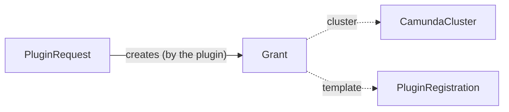

# Grant

A `Grant` asks the cloud identity of a cluster for one permission, on behalf of a [PluginRequest](pluginrequest.md). A plugin writes one grant for each grant template of its [PluginRegistration](pluginregistration.md#grant-templates), for example the permission to read and write a backup bucket. The identity extension of the cluster applies the permission and writes the status.

`Grant` is namespaced. It lives in the namespace of its request. It is an alpha API in the group `plugins.camunda.io/v1alpha1`, and its fields can change in a later release.

The smallest grant:

```yaml
apiVersion: plugins.camunda.io/v1alpha1
kind: Grant
metadata:
  name: orders-backup-storage-bucket-access
  namespace: my-cluster-ns
  labels:
    plugins.camunda.io/registration: s3-backup-bucket
    plugins.camunda.io/request: orders-backup-storage
    plugins.camunda.io/cluster: orders
spec:
  cluster:
    name: orders
  template: bucket-access
  format: aws-iam-statement
  fragment:
    Effect: Allow
    Action: ["s3:GetObject", "s3:PutObject"]
    Resource: ["arn:aws:s3:::orders-backup-storage/*"]
```



## Labels

Each grant carries three labels that you can select on:

| Label | Value |
| --- | --- |
| `plugins.camunda.io/registration` | The name of the registration that holds the template. |
| `plugins.camunda.io/request` | The name of the request that the grant belongs to. |
| `plugins.camunda.io/cluster` | The name of the `CamundaCluster` whose identity gets the permission. |

The plugin sets all three labels. The API server refuses a grant without the label `plugins.camunda.io/registration`. See [Who can write a grant](#who-can-write-a-grant).

To list the permissions of one cluster:

```bash
kubectl get grants -n my-cluster-ns -l plugins.camunda.io/cluster=orders
```

## Format

`spec.format` is the format of `spec.fragment`. The only format today is `aws-iam-statement`: one AWS IAM policy statement, as a JSON object.

## Who can write a grant

A plugin chart gives the ServiceAccount of its controller the RBAC verb `serve` on its own registrations. Put the names of these registrations in `resourceNames`. A `PluginRegistration` is cluster-scoped, so `serve` needs a ClusterRole that a ClusterRoleBinding binds. A RoleBinding of the ClusterRole does not give `serve`. The same role gives the controller write access to grants. The repository holds this example as `config/plugins/example_serve_clusterrole.yaml`:

```yaml
apiVersion: rbac.authorization.k8s.io/v1
kind: ClusterRole
metadata:
  name: s3-backup-bucket-controller
rules:
- apiGroups: ["plugins.camunda.io"]
  resources: ["pluginregistrations"]
  resourceNames: ["s3-backup-bucket"]
  verbs: ["serve"]
- apiGroups: ["plugins.camunda.io"]
  resources: ["grants"]
  verbs: ["get", "list", "watch", "create", "update", "patch", "delete"]
---
apiVersion: rbac.authorization.k8s.io/v1
kind: ClusterRoleBinding
metadata:
  name: s3-backup-bucket-controller
roleRef:
  apiGroup: rbac.authorization.k8s.io
  kind: ClusterRole
  name: s3-backup-bucket-controller
subjects:
- kind: ServiceAccount
  namespace: camunda-plugins
  name: s3-backup-bucket-controller
```

The chart does not ship an admission policy of its own. The operator installs one policy for all plugins. With `install.yaml`, its name is `camunda-operator-plugins.camunda.io-grant-author`. With a Helm install, the name depends on the release. To find it, run `kubectl get validatingadmissionpolicies`.

The API server admits a grant from a requester that has `serve` on the registration that the label `plugins.camunda.io/registration` names. The grant must have this label, with a value that is not empty. Its `spec.format` must be `aws-iam-statement`. A change of the label needs `serve` on the old registration and on the new registration. Thus the controller of one registration cannot take the grant of another registration.

Otherwise the API server refuses the request. `kubectl` prints the cause:

```text
Error from server (Forbidden): error when creating "grant.yaml": grants.plugins.camunda.io "orders-backup-storage-bucket-access" is forbidden: ValidatingAdmissionPolicy 'camunda-operator-plugins.camunda.io-grant-author' with binding 'camunda-operator-plugins.camunda.io-grant-author-binding' denied request: the requester system:serviceaccount:camunda-plugins:stranger does not have the verb serve on the PluginRegistration s3-backup-bucket, so it cannot write a Grant for it
```

| Cause | Message | What to do |
| --- | --- | --- |
| The label is missing or empty. | `a Grant must carry the label plugins.camunda.io/registration with the name of the PluginRegistration that it belongs to` | Set the label to the name of the registration that holds the template. |
| The requester does not have `serve` on the registration in the label. After a change of the label, this is the new registration. | `the requester <user> does not have the verb serve on the PluginRegistration <name>, so it cannot write a Grant for it` | Give the ServiceAccount of the controller `serve` on that registration, as in the role above. Or correct the label. |
| The requester changed the label, and it does not have `serve` on the old registration. | `the requester <user> does not have the verb serve on the PluginRegistration <name>, so it cannot change a Grant of it` | Change the label only as a requester with `serve` on both registrations. Or create a new grant for the new registration. |
| The format is not `aws-iam-statement`. | `spec.format: Unsupported value: "<format>": supported values: "aws-iam-statement"` | Set `spec.format: aws-iam-statement`. |

Some writes do not need `serve`. The identity extension writes the status of a grant without it. A change of metadata other than the labels does not need it either, for example an annotation or an owner reference. Kubernetes removes the owner reference when the request of a grant is deleted with the `Orphan` propagation policy. A change of the spec or of a label always needs `serve`. The policy does not check a delete. A plugin with the verb `delete` on grants can delete the grant of another plugin.

A user with the verb `*` on `pluginregistrations`, for example through the ClusterRole `cluster-admin`, has `serve` on every registration.

## Deletion

Each grant has an owner reference to its request. With the deletion policy `Delete`, Kubernetes deletes the grants when the request goes away. With `Orphan`, a grant that `status.resources` of the request lists with `onOrphan: Kept` stays, without the owner reference. See [Deletion](pluginrequest.md#deletion).

`spec.cluster.name` and the label `plugins.camunda.io/cluster` are `spec.target.name` of the request. A grant always gives its permission to the cluster that its request serves:

```yaml
apiVersion: plugins.camunda.io/v1alpha1
kind: Grant
metadata:
  name: orders-backup-storage-bucket-access
  namespace: my-cluster-ns
  labels:
    plugins.camunda.io/cluster: orders
  ownerReferences:
    - apiVersion: plugins.camunda.io/v1alpha1
      kind: PluginRequest
      name: orders-backup-storage
      uid: 4b8d5f3e-1c2a-4e7f-9a0b-6d3c2e1f0a9b
spec:
  cluster:
    name: orders
  # ... the rest of your grant
```

## Status

| Type | Reason | Meaning | What to do |
| --- | --- | --- | --- |
| `Applied` | `Healthy` | The identity extension applied the fragment. | Nothing. |
| `Applied` | `OverCeiling` | The fragment asks for more than the ceiling of the identity extension allows. | Ask the admin of the identity extension to raise the ceiling, or change the parameters of the request. |
| `Applied` | `OverSizeLimit` | The fragment takes the policy of the identity over the size limit of the cloud. | Select fewer options that ask for permissions for this cluster. |
| `Applied` | `Rejected` | The identity extension or the cloud refused the fragment for another reason. The message says why. | Read the message. |
| `MatchesTemplate` | `Healthy` | The fragment matches its template in the registration. | Nothing. |
| `MatchesTemplate` | `TemplateChanged` | The fragment no longer matches its template in the registration. | Wait for the plugin to write the grant again from the new template. |
| `Ready` | `Healthy` | `Applied` and `MatchesTemplate` are both `True`. | Nothing. |
| `Ready` | the reason of the first `False` condition | `Applied` or `MatchesTemplate` is `False`. The message is the message of that condition. | See the row of that reason. |

A grant with `Ready=False` makes the `Ready` condition of its request `False` with reason `GrantRejected`. When no grant of a request has `Ready=False`, a grant without `Ready=True` makes the `Ready` condition of the request `False` with reason `WaitingForGrants`. The outputs of the request stay usable in both cases.

## Fields

The [API reference](api-reference.md#grant) lists every field of `Grant`, with its type, whether it is required, its default, and its validation. It does not list the labels. [Labels](#labels) describes them.

## Validation rules

The API server refuses a change of these fields after the grant is created:

- `cluster`: `cluster is immutable: delete the grant and create a new one`.
- `template`: `template is immutable: delete the grant and create a new one`.
- `format`: `format is immutable: delete the grant and create a new one`.

It also refuses a name longer than 63 characters: `metadata.name must be at most 63 characters, because it is used as a label value`.

## Related

- [PluginRequest](pluginrequest.md): the request that the grant belongs to.
- [PluginRegistration](pluginregistration.md#grant-templates): the templates that the grants come from.
- [API reference](api-reference.md#grant): every field of the kind.
