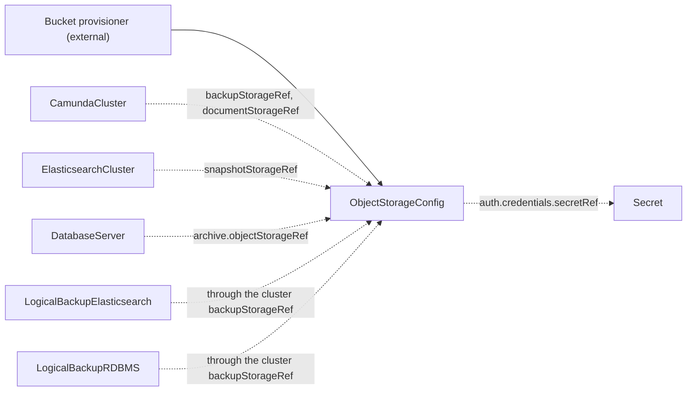

# ObjectStorageConfig

`ObjectStorageConfig` is a namespaced [contract](index.md#contracts) kind that describes one bucket, for backups or for document storage, and how consumers authenticate to it. You create it, or another tool creates it for you.

The operator never creates a bucket. This kind carries the location of a bucket that exists, and the authentication choice. The producer of the bucket and the resources that write to it do not need to know each other. The operator checks the Secret that the contract names and reports the result on `Ready`.

| Role | Who |
| --- | --- |
| Producers | You, by hand, or another tool that provisions the bucket and creates the contract for you |
| Consumers | [CamundaCluster](camundacluster.md) (through `backupStorageRef` and `documentStorageRef`), [ElasticsearchCluster](elasticsearchcluster.md) (through `snapshotStorageRef`), [DatabaseServer](databaseserver.md) (through `archive.objectStorageRef`), [LogicalBackupElasticsearch](logicalbackupelasticsearch.md) and [LogicalBackupRDBMS](logicalbackuprdbms.md) (through the `backupStorageRef` of the cluster they back up) |

A consumer names the contract and reads it in its own namespace. A `CamundaCluster` in `my-cluster-ns` with `backupStorageRef: my-backup-bucket` reads the contract `my-backup-bucket` of `my-cluster-ns`. A contract of the same name in another namespace is a different bucket. Two consumers in one namespace can share one contract. A consumer in another namespace needs a contract of its own, even when both point at one bucket.

`spec.type` selects the storage API of the bucket. Exactly the block with the same name carries its fields: `s3`, `gcs`, or `azureBlob`. Each block has its own `auth` block, because the three storage types authenticate in different ways.

The smallest contract names an AWS bucket, accessed through IRSA (IAM Roles for Service Accounts on EKS):

```yaml
apiVersion: core.camunda.io/v1
kind: ObjectStorageConfig
metadata:
  name: my-backup-bucket
  namespace: my-cluster-ns
spec:
  type: S3
  s3:
    bucketName: my-cluster-backup-bucket
    region: eu-west-1
    auth:
      type: workloadIdentity
      workloadIdentity:
        roleArn: "arn:aws:iam::123456789012:role/my-cluster-workload-role"
```



## Authentication

`auth.type` selects one of two mechanisms. `workloadIdentity` is the default. No credentials pass through Kubernetes. The cloud binds a principal to the ServiceAccount of the consuming pods, and each pod gets a token from its runtime. The optional `workloadIdentity` block names that principal. When you set it, the consumer writes the matching annotation on the ServiceAccount of its pods:

| Storage type | Field | Annotation on the ServiceAccount |
| --- | --- | --- |
| `S3` | `roleArn` | `eks.amazonaws.com/role-arn` |
| `GCS` | `serviceAccountEmail` | `iam.gke.io/gcp-service-account` |
| `AzureBlob` | `clientId` | `azure.workload.identity/client-id` |

The operator writes the annotation only on a ServiceAccount that it creates. With `serviceAccount.create: false`, add the annotation to your ServiceAccount yourself.

On `AzureBlob` with `workloadIdentity`, the consumer also puts the label `azure.workload.identity/use: "true"` on its pods. The Azure webhook injects nothing into a pod without that label.

An empty or absent `workloadIdentity` block means that the consumer adds no annotation. The cloud then trusts the ServiceAccount of the pods as it is. Use it for mechanisms that need no annotation, for example EKS Pod Identity and GKE Workload Identity Federation. There the binding lives on the cloud side and names the ServiceAccount. The principal to bind is `system:serviceaccount:<namespace>:<serviceAccount name>` of the consuming resource. By default, that ServiceAccount is `<name>-camunda` for a `CamundaCluster` and `<name>-es` for an `ElasticsearchCluster`. For a `DatabaseServer`, it is `<name>-postgres`, and a rollback does not change it. See [DatabaseServer](databaseserver.md#authentication-to-the-bucket).

`credentials` names a Secret of the namespace of the contract that holds a static key. Use it for S3-compatible storage such as MinIO or Ceph, and for a cloud bucket that you access with keys. The shape of the Secret differs per storage type. `S3` takes an access key pair, `GCS` a service-account JSON key, and `AzureBlob` an account key.

## Validation checks

With `auth.type: credentials`, the operator makes sure that the Secret exists in the namespace of the contract and holds the configured keys. The operator checks again when you edit the contract or the Secret. With `type: workloadIdentity`, there is nothing to check, and `Ready` is `True`. The operator does not reach the bucket to test it.

## Deletion

Deleting the contract removes nothing from the bucket. A consumer that references it reports the missing reference on its own `Ready` condition.

## Status

`kubectl get objectstorageconfig` shows `Ready`, its reason, the storage type, and the age.

| Type | Reason | Meaning | What to do |
| --- | --- | --- | --- |
| `Ready` | `Healthy` | The contract is valid. A Secret in `auth.credentials`, if any, exists and holds the configured keys. | Nothing. |
| `Ready` | `MissingSecret` | The Secret of `auth.credentials` is missing, or it lacks a configured key. | Create the Secret, or add the key. The message names the Secret and the key. |

A missing key reads:

```yaml
status:
  conditions:
    - type: Ready
      status: "False"
      reason: MissingSecret
      message: Secret my-cluster-ns/minio-credentials is missing key "secretAccessKey"
```

`status.observedGeneration` is the last generation of the contract that the operator validated.

## Fields

The [API reference](api-reference.md#objectstorageconfig) lists every field of `ObjectStorageConfig`, with its type, whether it is required, its default, and its validation.

## Validation rules

- Exactly the block that matches `spec.type` must be set: `S3` with `s3`, `GCS` with `gcs`, and `AzureBlob` with `azureBlob`.
- In every `auth` block, `credentials` is required when `auth.type` is `credentials`, and forbidden otherwise.
- In every `auth` block, `workloadIdentity` is only valid when `auth.type` is `workloadIdentity`.
- `s3.region` is required unless `s3.endpoint` is set. With an endpoint and no region, every consumer sends the placeholder region `us-east-1`. An S3-compatible store ignores it. If your store does not ignore it, set `region`.
- `s3.endpoint` and `azureBlob.endpoint` must be valid `http` or `https` URLs.
- A `basePath`, when set, must match `^[^/]+(/[^/]+)*$`: a plain prefix without leading or trailing slashes. An empty string is rejected. Omit the field to use the bucket root.
- `bucketName`, `accountName`, `container`, and every Secret reference field must not be empty.
- The API server accepts a contract whose `auth.credentials` Secret does not exist yet, so you can create the Secret after the contract. The contract reports the missing Secret on `Ready`.
- No field is immutable.

## S3 with EKS Pod Identity

A bucket bound through EKS Pod Identity, which needs no annotation. Bind the principal `system:serviceaccount:my-cluster-ns:my-cluster-camunda` on the cloud side:

```yaml
apiVersion: core.camunda.io/v1
kind: ObjectStorageConfig
metadata:
  name: my-backup-bucket
  namespace: my-cluster-ns
spec:
  type: S3
  s3:
    bucketName: my-cluster-backup-bucket
    region: eu-west-1
    auth:
      type: workloadIdentity
```

## S3-compatible storage with static credentials

S3-compatible storage with static keys, the shape that MinIO and Ceph need:

```yaml
apiVersion: core.camunda.io/v1
kind: ObjectStorageConfig
metadata:
  name: my-backup-bucket
  namespace: my-cluster-ns
spec:
  type: S3
  s3:
    bucketName: camunda-backups
    basePath: clusters
    endpoint: "http://minio.minio.svc:9000"
    forcePathStyle: true
    auth:
      type: credentials
      credentials:
        secretRef:
          name: minio-credentials
          accessKeyIdKey: accessKeyId
          secretAccessKeyKey: secretAccessKey
```

## GCS for document storage

A document storage bucket on Google Cloud, scoped to a key prefix:

```yaml
apiVersion: core.camunda.io/v1
kind: ObjectStorageConfig
metadata:
  name: my-document-bucket
  namespace: my-cluster-ns
spec:
  type: GCS
  gcs:
    bucketName: my-cluster-documents
    basePath: documents
    auth:
      type: workloadIdentity
      workloadIdentity:
        serviceAccountEmail: "my-cluster-workload@my-project.iam.gserviceaccount.com"
```

## Related

- [CamundaCluster](camundacluster.md): consumes this contract through `backupStorageRef` for backups and `documentStorageRef` for document storage.
- [ElasticsearchCluster](elasticsearchcluster.md): consumes this contract through `snapshotStorageRef` for its snapshot repository.
- [LogicalBackupElasticsearch](logicalbackupelasticsearch.md) and [LogicalBackupRDBMS](logicalbackuprdbms.md): write to the bucket that the `backupStorageRef` of the cluster names.
- [Backup guide](../guides/backup.md): how to set up a backup bucket and take a backup.
- [Getting started](../getting-started.md): the order in which you create the resources.
