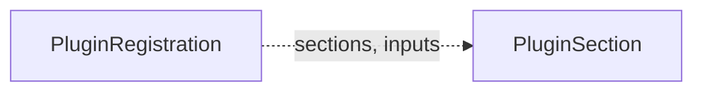

# PluginRegistration

A `PluginRegistration` is one option that a plugin offers in one or more [PluginSections](pluginsection.md), for example "New S3 bucket" in the section `backup-storage`. It says what the option reads from other sections, what it writes, what a claim can change, and which permissions it asks for. A plugin controller writes its registration from its chart values. The operator writes the built-in registrations.

`PluginRegistration` is cluster-scoped. It is an alpha API in the group `plugins.camunda.io/v1alpha1`, and its fields can change in a later release.

The smallest registration:

```yaml
apiVersion: plugins.camunda.io/v1alpha1
kind: PluginRegistration
metadata:
  name: s3-backup-bucket
spec:
  sections:
    - backup-storage
  label: New S3 bucket
  mode: Optional
  serviceAccount:
    namespace: camunda-plugins
    name: s3-backup-bucket-controller
  deletionPolicies:
    - Delete
```



## Built-in registrations

The operator writes six built-in registrations:

| Name | Section | Mode | Parameters | Claim-editable | Inputs | Outputs |
| --- | --- | --- | --- | --- | --- | --- |
| `elasticsearch` | `secondary-storage` | `Default` | `preset` (required), `overrides`: `replicas`, `resources`, `storageSize`, `scheduling`, `podLabels` | `overrides` | `volume-encryption/storageClassName`, `backup-storage/objectStorageConfig`, `cloud-identity/serviceAccountAnnotations` | `secondaryStorageConfig` |
| `database-server` | `secondary-storage` | `Optional` | `preset` (required), `overrides`: `instances`, `resources`, `storageSize`, `scheduling`, `podLabels` | `overrides` | `volume-encryption/storageClassName`, `backup-storage/objectStorageConfig`, `cloud-identity/serviceAccountAnnotations` | `secondaryStorageConfig` |
| `existing-secondary-storage` | `secondary-storage` | `Optional` | `name` (required): a `SecondaryStorageConfig` in the namespace of the claim | none | none | `secondaryStorageConfig` |
| `existing-object-storage` | `backup-storage` | `Optional` | `name` (required): an `ObjectStorageConfig` in the namespace of the claim | none | none | `objectStorageConfig` |
| `management-database-server` | `management-database` | `Default` | `preset` (required), `databases` | none | `volume-encryption/storageClassName` | `keycloakDatabaseConfig`, `identityDatabaseConfig`, `webModelerDatabaseConfig` |
| `existing-database-configs` | `management-database` | `Optional` | `keycloak`, `identity`, `webModeler`: `DatabaseConfig` names | none | none | `keycloakDatabaseConfig`, `identityDatabaseConfig`, `webModelerDatabaseConfig` |

Without an `Environment`, a new cluster claim selects `elasticsearch` for its secondary storage, and a new management plane claim selects `management-database-server` for its databases. A claim selects the other options only when you pick them.

Every input of a built-in registration is optional. Every built-in registration supports the deletion policies `Delete` and `Orphan`. The registrations of existing resources write nothing, so both policies keep everything in place.

The operator serves the requests of `existing-object-storage`, `existing-secondary-storage`, and `existing-database-configs`. See [Built-in requests](pluginrequest.md#built-in-requests).

Each built-in registration has `controller.name: camunda-operator`, and `controller.version` is the version of the operator. `serviceAccount` names the ServiceAccount of the operator. `operatorVersions` is empty, because the operator serves these options itself.

The operator writes the built-in registrations each time the manager starts:

- A built-in registration that you delete comes back at the next start.
- A field of a built-in registration that you change goes back to its value at the next start.
- A field that the operator does not write stays, for example `docsUrl` or a label that you add to `metadata.labels`.
- The operator never deletes a registration, also when a later release no longer writes it.

The operator writes these fields with the field manager `camunda-operator-builtins`. A GitOps tool that writes the same fields shows this name in its conflict message.

## Mode

`mode` says what a new claim selects when no [`Environment`](index.md#planned-kinds) applies to its namespace:

- `Default`: a new claim selects the option. A section has at most one `Default` option.
- `Optional`: the fleet manager offers the option, and a new claim does not select it.

## Inputs and outputs

An input reads one output of another section, in the form `<section>/<output>`, for example `encryption-key/keyRef`. The claim gives the value of the output to the request of this option. With `required: true`, a claim cannot select the option while the input has no value. `formats` lists the formats of the value that the option accepts, for example `aws-kms-arn`. An empty list accepts every format.

`outputs` lists the values that the plugin writes to the status of a request. It includes the outputs of each section that the option serves.

## Parameters

`parameters` is the OpenAPI v3 schema of the parameters of a request for the option. `parameterValues` are the values that the admin set in the plugin chart. `claimEditable` lists the parameters that a claim can change. An `Environment` can override `parameterValues` and `claimEditable`. Without one, these two fields apply.

`choices` are the presets or existing resources that a claim can pick for a parameter, with the facts that the fleet manager shows for each.

## Grant templates

Each entry of `grantTemplates` is one permission statement that the option asks for. The plugin writes one [Grant](grant.md) for each template. The template is a JSON object with Go template placeholders:

| Placeholder | Value |
| --- | --- |
| `{{ .namespace }}` | The namespace of the request. |
| `{{ .claim }}` | The name of the claim. |
| `{{ .request }}` | The name of the `PluginRequest`. |
| `{{ .serviceAccount }}` | `spec.target.serviceAccountName` of the request. |
| `{{ .parameters.<name> }}` | A parameter of the request. |
| `{{ .outputs.<key> }}` | An output of the request. |

`requiresInputs` names the inputs that must have a value before the plugin writes the grant. A metric query in `metricQueries` uses the same placeholders, and also `{{ .pods }}`, a regular expression of the pod names of the request.

## Acceptance

The operator checks each registration and reports the result in the `Accepted` condition. The fleet manager offers the option only when `Accepted` and `Ready` are both `True`. The operator sets only `Accepted`. The plugin controller sets `Ready`.

The operator accepts a registration when all of these are true:

- Each name in `spec.sections` names a `PluginSection`.
- The version of the operator is inside `spec.operatorVersions`.
- In each section, no other registration has `mode: Default` when this one has it.

```yaml
apiVersion: plugins.camunda.io/v1alpha1
kind: PluginRegistration
metadata:
  name: s3-backup-bucket
spec:
  sections:
    - backup-storage
  mode: Optional
  operatorVersions: ">=0.3.0 <1.0.0"
  # ... the rest of your registration
```

A registration without `operatorVersions` works with every operator version. A prerelease of the operator, such as `0.3.0-rc.1`, is outside a range like `>=0.3.0 <1.0.0`. To include the prereleases, write `>=0.3.0-0 <1.0.0`.

When a check fails, `Accepted` is `False`. The message names the missing sections, the version and the range, or the other `Default` registrations. The checks run in the order of the list above, and the message names the first failure only. The operator checks the registration again when one of its sections, or another registration of one of its sections, is created, changed, or deleted.

```yaml
status:
  conditions:
    - type: Accepted
      status: "False"
      reason: DefaultConflict
      message: "In section backup-storage, these registrations also have mode Default: rustfs-bucket"
```

When two registrations of one section both have `mode: Default`, both report `DefaultConflict`. Set `mode: Optional` on one of them, and both become `Accepted` again.

A plugin controller that writes the status of its registration must keep the `Accepted` condition that it finds there. For example, when it updates the whole status, it sends the `Accepted` condition back unchanged.

## Status

| Type | Reason | Meaning | What to do |
| --- | --- | --- | --- |
| `Accepted` | `Healthy` | The operator accepts the registration. | Nothing. |
| `Accepted` | `SectionMissing` | A section in `spec.sections` does not exist. The message names it. | Install the plugin chart that brings the section, or fix the name. |
| `Accepted` | `OperatorVersionUnsupported` | The version of the operator is outside `spec.operatorVersions`, or the range is not valid. The message names the version and the range. | Install a plugin version that supports this operator, or upgrade the operator. |
| `Accepted` | `DefaultConflict` | Another registration of the same section also has mode `Default`. The message names it. | Set `mode: Optional` on all but one of them. |
| `Ready` | set by the plugin | The plugin controller reports its health and its credentials. | Read the message, and the logs of the plugin controller. |

`status.observedGeneration` is the last generation that a controller of the registration processed.

## Fields

The [API reference](api-reference.md#pluginregistration) lists every field of `PluginRegistration`, with its type, whether it is required, its default, and its validation. The `label`, `description`, `docsUrl`, `controller`, `choices`, `limits`, and `metricQueries` fields change only what the fleet manager shows.

## Validation rules

The API server refuses a registration when:

- `sections` is empty: `sections must list at least one section`.
- `deletionPolicies` does not contain `Delete`: `deletionPolicies must contain Delete`.
- A `requiresInputs` item of a grant template names no input of the registration: `each requiresInputs item of a grant template must name an input of the registration`.
- An `inputs[].from` is not in the form `<section>/<output>`.
- Two inputs have the same `name`, two outputs have the same `key`, or two grant templates have the same `name`.
- `inputs` or `grantTemplates` has more than 32 items, or `deletionPolicies` has more than 2.
- The name is longer than 63 characters: `metadata.name must be at most 63 characters, because it is used as a label value`.

## A registration with inputs and grant templates

This option creates one S3 bucket for the backups of each cluster. It reads the key of the section `encryption-key` and asks for access to the bucket:

```yaml
apiVersion: plugins.camunda.io/v1alpha1
kind: PluginRegistration
metadata:
  name: s3-backup-bucket
spec:
  sections:
    - backup-storage
  label: New S3 bucket
  description: Creates one S3 bucket for the backups of each cluster.
  docsUrl: https://example.com/docs/s3-backup-bucket
  mode: Optional
  controller:
    name: s3-backup-bucket-controller
    version: 0.1.0
  serviceAccount:
    namespace: camunda-plugins
    name: s3-backup-bucket-controller
  operatorVersions: ">=0.3.0 <1.0.0"
  parameters:
    type: object
    properties:
      retentionDays:
        type: integer
        minimum: 1
  parameterValues:
    retentionDays: 30
  claimEditable:
    - retentionDays
  choices:
    - name: standard
      specs:
        - label: Retention
          value: 30 days
  inputs:
    - name: kmsKey
      from: encryption-key/keyRef
      required: false
      formats:
        - aws-kms-arn
  outputs:
    - key: objectStorageConfig
      description: The name of the ObjectStorageConfig that points at the bucket.
  limits:
    - label: Region
      value: eu-west-1
      description: The chart creates every bucket in this region.
  grantTemplates:
    - name: bucket-access
      format: aws-iam-statement
      description: Lets the cluster read and write its backups.
      requiresInputs:
        - kmsKey
      template:
        Effect: Allow
        Action: ["s3:GetObject", "s3:PutObject", "s3:ListBucket"]
        Resource: ["arn:aws:s3:::{{ .request }}", "arn:aws:s3:::{{ .request }}/*"]
  deletionPolicies:
    - Delete
    - Orphan
  metricQueries:
    - label: Bucket size
      query: 'sum(aws_s3_bucket_size_bytes{bucket="{{ .request }}"})'
      unit: bytes
```

## Related

- [PluginSection](pluginsection.md): the sections that a registration serves.
- [PluginRequest](pluginrequest.md): the request that a claim writes when it selects the option.
- [Grant](grant.md): the permissions that the plugin writes from the grant templates.
- [API reference](api-reference.md#pluginregistration): every field of the kind.
