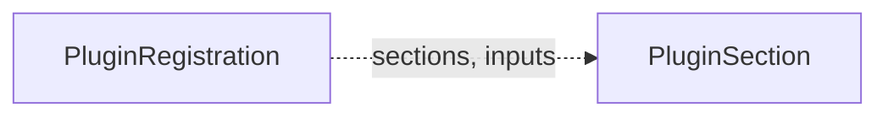

# PluginRegistration

A `PluginRegistration` is one option that a plugin offers in one or more [PluginSections](pluginsection.md), for example "New S3 bucket" in the section `backup-storage`. It says what the option reads from other sections, what it writes, what a claim can change, and which permissions it asks for. A plugin controller writes its registration from its chart values. The operator writes the built-in registrations.

`PluginRegistration` is cluster-scoped. It is an alpha API in the group `plugins.camunda.io/v1alpha1`, and its fields can change in a later release.

The smallest registration:

```yaml
apiVersion: plugins.camunda.io/v1alpha1
kind: PluginRegistration
metadata:
  name: s3-backup-bucket
spec:
  sections:
    - backup-storage
  label: New S3 bucket
  mode: Optional
  serviceAccount:
    namespace: camunda-plugins
    name: s3-backup-bucket-controller
  deletionPolicies:
    - Delete
```



## Built-in registrations

The operator writes six built-in registrations:

| Name | Section | Mode | Parameters | Claim-editable | Inputs | Outputs |
| --- | --- | --- | --- | --- | --- | --- |
| `elasticsearch` | `secondary-storage` | `Default` | `preset` (required), `overrides`: `replicas`, `resources`, `storageSize`, `scheduling`, `podLabels` | `overrides` | `volume-encryption/storageClassName`, `backup-storage/objectStorageConfig`, `cloud-identity/serviceAccountAnnotations` | `secondaryStorageConfig` |
| `database-server` | `secondary-storage` | `Optional` | `preset` (required), `overrides`: `instances`, `resources`, `storageSize`, `scheduling`, `podLabels` | `overrides` | `volume-encryption/storageClassName`, `backup-storage/objectStorageConfig`, `cloud-identity/serviceAccountAnnotations` | `secondaryStorageConfig` |
| `existing-secondary-storage` | `secondary-storage` | `Optional` | `name` (required): a `SecondaryStorageConfig` in the namespace of the claim | none | none | `secondaryStorageConfig` |
| `existing-object-storage` | `backup-storage` | `Optional` | `name` (required): an `ObjectStorageConfig` in the namespace of the claim | none | none | `objectStorageConfig` |
| `management-database-server` | `management-database` | `Default` | `preset` (required), `databases` | none | `volume-encryption/storageClassName` | `keycloakDatabaseConfig`, `identityDatabaseConfig`, `webModelerDatabaseConfig` |
| `existing-database-configs` | `management-database` | `Optional` | `keycloak`, `identity`, `webModeler`: `DatabaseConfig` names | none | none | `keycloakDatabaseConfig`, `identityDatabaseConfig`, `webModelerDatabaseConfig` |

Without an `Environment`, a new cluster claim selects `elasticsearch` for its secondary storage, and a new management plane claim selects `management-database-server` for its databases. A claim selects the other options only when you pick them.

Every input of a built-in registration is optional. Every built-in registration supports the deletion policies `Delete` and `Orphan`. The registrations of existing resources write nothing, so both policies keep everything in place.

Each built-in registration has `controller.name: camunda-operator`, and `controller.version` is the version of the operator. `serviceAccount` names the ServiceAccount of the operator. `operatorVersions` is empty, because the operator serves these options itself.

The operator writes the built-in registrations each time the manager starts:

- A built-in registration that you delete comes back at the next start.
- A field of a built-in registration that you change goes back to its value at the next start.
- A field that the operator does not write stays, for example `docsUrl` or a label that you add to `metadata.labels`.
- The operator never deletes a registration, also when a later release no longer writes it.

The operator writes these fields with the field manager `camunda-operator-builtins`. A GitOps tool that writes the same fields shows this name in its conflict message.

## Mode

`mode` says what a new claim selects when no [`Environment`](index.md#planned-kinds) applies to its namespace:

- `Default`: a new claim selects the option. A section has at most one `Default` option.
- `Optional`: the fleet manager offers the option, and a new claim does not select it.

## Inputs and outputs

An input reads one output of another section, in the form `<section>/<output>`, for example `encryption-key/keyRef`. The claim gives the value of the output to the request of this option. With `required: true`, a claim cannot select the option while the input has no value. `formats` lists the formats of the value that the option accepts, for example `aws-kms-arn`. An empty list accepts every format.

`outputs` lists the values that the plugin writes to the status of a request. It includes the outputs of each section that the option serves.

## Parameters

`parameters` is the OpenAPI v3 schema of the parameters of a request for the option. `parameterValues` are the values that the admin set in the plugin chart. `claimEditable` lists the parameters that a claim can change. An `Environment` can override `parameterValues` and `claimEditable`. Without one, these two fields apply.

`choices` are the presets or existing resources that a claim can pick for a parameter, with the facts that the fleet manager shows for each.

## Grant templates

Each entry of `grantTemplates` is one permission statement that the option asks for. The plugin writes one [Grant](grant.md) for each template. The template is a JSON object with Go template placeholders:

| Placeholder | Value |
| --- | --- |
| `{{ .namespace }}` | The namespace of the request. |
| `{{ .claim }}` | The name of the claim. |
| `{{ .request }}` | The name of the `PluginRequest`. |
| `{{ .serviceAccount }}` | `spec.target.serviceAccountName` of the request. |
| `{{ .parameters.<name> }}` | A parameter of the request. |
| `{{ .outputs.<key> }}` | An output of the request. |

`requiresInputs` names the inputs that must have a value before the plugin writes the grant. A metric query in `metricQueries` uses the same placeholders, and also `{{ .pods }}`, a regular expression of the pod names of the request.

## Status

| Type | Reason | Meaning | What to do |
| --- | --- | --- | --- |
| `Accepted` | `Healthy` | The operator accepts the registration. | Nothing. |
| `Accepted` | `SectionMissing` | A section in `sections` does not exist. | Install the plugin chart that brings the section, or fix the name. |
| `Accepted` | `OperatorVersionUnsupported` | The version of the operator is outside `operatorVersions`, or the range is not valid. | Install a plugin version that supports this operator version. |
| `Accepted` | `DefaultConflict` | Another registration of the same section also has mode `Default`. | Set one of the two registrations to `Optional`. |
| `Ready` | set by the plugin | The plugin controller reports its health and its credentials. | Read the message, and the logs of the plugin controller. |

The operator sets `Accepted`. The plugin controller sets `Ready`. The fleet manager offers the option only when both are `True`.

`status.observedGeneration` is the last generation that a controller of the registration processed.

## Spec reference

Every field, with its type, whether it is required, and its default:

```yaml
apiVersion: plugins.camunda.io/v1alpha1
kind: PluginRegistration
metadata:
  # string. Required. The name of the registration. At most 63 characters.
  name: s3-backup-bucket
spec:
  # list of strings. Required. The names of the sections that the option serves. At least one.
  sections:
    - backup-storage
  # string. Required. The name of the option in the fleet manager. It names the outcome.
  label: New S3 bucket
  # string. Optional. What the option does.
  description: Creates one S3 bucket for the backups of each cluster.
  # string. Optional. The address of the documentation of the option.
  docsUrl: https://example.com/docs/s3-backup-bucket
  # Default or Optional. Required. See "Mode".
  mode: Optional
  # object. Optional. The plugin controller that serves the option.
  controller:
    # string. Required. The name of the plugin controller.
    name: s3-backup-bucket-controller
    # string. Optional. The version of the plugin controller.
    version: 0.1.0
  # object. Required. The ServiceAccount of the plugin controller.
  serviceAccount:
    # string. Required. A namespace name.
    namespace: camunda-plugins
    # string. Required. A ServiceAccount name.
    name: s3-backup-bucket-controller
  # string. Optional. The semver range of the operator versions that the plugin supports. Empty accepts every version.
  operatorVersions: ">=0.3.0 <1.0.0"
  # object. Optional. The OpenAPI v3 schema of the parameters of a request.
  parameters:
    type: object
    properties:
      retentionDays:
        type: integer
        minimum: 1
  # object. Optional. The parameter values that the admin set in the plugin chart.
  parameterValues:
    retentionDays: 30
  # list of strings. Optional. The parameters that a claim can change.
  claimEditable:
    - retentionDays
  # list. Optional. The presets or existing resources that a claim can pick for a parameter.
  choices:
      # string. Required. The value that the claim stores.
    - name: standard
      # list. Optional. The facts that the fleet manager shows for the choice.
      specs:
          # string. Required. The name of the fact.
        - label: Retention
          # string. Required. The value of the fact.
          value: 30 days
  # list. Optional, at most 32. The values that the option reads from other sections.
  inputs:
      # string. Required. The name of the input. At most 63 characters.
    - name: kmsKey
      # string. Required. The output that gives the value, as <section>/<output>.
      from: encryption-key/keyRef
      # boolean. Optional, default: false. Refuse a selection while the input has no value.
      required: false
      # list of strings. Optional. The formats that the option accepts. Empty accepts every format.
      formats:
        - aws-kms-arn
  # list. Optional. The values that the plugin writes to the status of a request.
  outputs:
      # string. Required. A letter, then letters and digits.
    - key: objectStorageConfig
      # string. Optional. What the value is.
      description: The name of the ObjectStorageConfig that points at the bucket.
      # string. Optional. The format of the value.
      # format: aws-kms-arn
  # list. Optional. The values that the plugin chart fixes, which no Environment and no claim can change.
  limits:
      # string. Required. The name of the limit.
    - label: Region
      # string. Required. The value of the limit.
      value: eu-west-1
      # string. Optional. What the limit means for a claim.
      description: The chart creates every bucket in this region.
  # list. Optional, at most 32. The permission statements that the option asks for.
  grantTemplates:
      # string. Required. The name of the template.
    - name: bucket-access
      # aws-iam-statement. Required. The format of the statement.
      format: aws-iam-statement
      # string. Optional. What the permission is for.
      description: Lets the cluster read and write its backups.
      # list of strings. Optional, at most 32. The inputs that must have a value first.
      requiresInputs:
        - kmsKey
      # object. Required. The statement, with placeholders.
      template:
        Effect: Allow
        Action: ["s3:GetObject", "s3:PutObject", "s3:ListBucket"]
        Resource: ["arn:aws:s3:::{{ .request }}", "arn:aws:s3:::{{ .request }}/*"]
  # list of Delete or Orphan. Required. The deletion policies that the plugin supports. It must contain Delete.
  deletionPolicies:
    - Delete
    - Orphan
  # list. Optional. The Prometheus queries that the fleet manager shows for a request.
  metricQueries:
      # string. Required. The name of the metric.
    - label: Bucket size
      # string. Required. PromQL with placeholders.
      query: 'sum(aws_s3_bucket_size_bytes{bucket="{{ .request }}"})'
      # string. Optional. The unit of the value.
      unit: bytes
```

The `label`, `description`, `docsUrl`, `controller`, `choices`, `limits`, and `metricQueries` fields change only what the fleet manager shows.

### Validation rules

The API server refuses a registration when:

- `sections` is empty: `sections must list at least one section`.
- `deletionPolicies` does not contain `Delete`: `deletionPolicies must contain Delete`.
- A `requiresInputs` item of a grant template names no input of the registration: `each requiresInputs item of a grant template must name an input of the registration`.
- An `inputs[].from` is not in the form `<section>/<output>`.
- Two inputs have the same `name`, two outputs have the same `key`, or two grant templates have the same `name`.
- `inputs` or `grantTemplates` has more than 32 items, or `deletionPolicies` has more than 2.
- The name is longer than 63 characters: `metadata.name must be at most 63 characters, because it is used as a label value`.

## Related

- [PluginSection](pluginsection.md): the sections that a registration serves.
- [PluginRequest](pluginrequest.md): the request that a claim writes when it selects the option.
- [Grant](grant.md): the permissions that the plugin writes from the grant templates.
- [API reference](api-reference.md#pluginregistration): every field of the kind.
