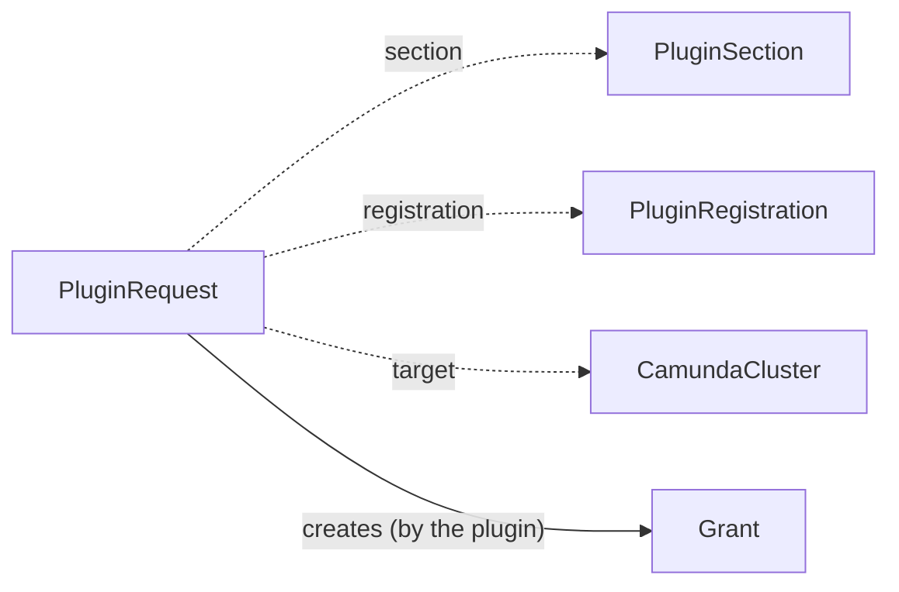

# PluginRequest

A `PluginRequest` asks a plugin for the resources of one section of a claim. A claim writes one request for each option that it selects, for example the request `orders-backup-storage` of the claim `orders`. The plugin that serves the [PluginRegistration](pluginregistration.md) of the option writes the status: its outputs, its health, and the resources that it made.

`PluginRequest` is namespaced. It lives in the namespace of its claim. It is an alpha API in the group `plugins.camunda.io/v1alpha1`, and its fields can change in a later release.

The smallest request:

```yaml
apiVersion: plugins.camunda.io/v1alpha1
kind: PluginRequest
metadata:
  name: orders-backup-storage
  namespace: my-cluster-ns
spec:
  section: backup-storage
  registration: s3-backup-bucket
  claimRef:
    kind: CamundaClusterClaim
    name: orders
  target:
    kind: CamundaCluster
    name: orders
  deletionPolicy: Delete
```



## Labels

Each request carries three labels that you can select on:

| Label | Value |
| --- | --- |
| `plugins.camunda.io/section` | The name of the section. |
| `plugins.camunda.io/registration` | The name of the registration. |
| `fleet.camunda.io/claim` | The name of the claim. |

To list the requests of one claim:

```bash
kubectl get pluginrequests -n my-cluster-ns -l fleet.camunda.io/claim=orders
```

Each resource that a plugin writes for a request carries the labels `plugins.camunda.io/registration` and `plugins.camunda.io/request`.

A cluster-scoped resource, for example a StorageClass, also carries the label `plugins.camunda.io/request-namespace` with the namespace of the request. Two claims with the same name in two namespaces each get their own cluster-scoped resources, and this label tells them apart.

To list the StorageClasses of one request:

```bash
kubectl get storageclasses -l plugins.camunda.io/request=orders-backup-storage,plugins.camunda.io/request-namespace=my-cluster-ns
```

## Outputs

`status.outputs` holds the values that the plugin publishes for the request, by output key. Read them only when the condition `OutputsReady` is `True` and its `observedGeneration` equals `metadata.generation`. Before that, the outputs can belong to an older spec.

## Deletion

`spec.deletionPolicy` says what the plugin does with the resources of the request when the request is deleted:

- `Delete`: the plugin deletes the resources that it wrote for the request.
- `Orphan`: the plugin keeps the resources. A namespaced resource loses its owner reference to the request and keeps its labels. `status.resources[].onOrphan` says, for each resource, whether it is `Kept` or `Deleted` with this policy.

With both policies, the plugin deletes a route to a Service that no longer exists. The request goes away only after the plugin applies the policy. The claim copies its own deletion policy to the request before it deletes the request.

## Built-in requests

The operator serves the requests of six [built-in registrations](pluginregistration.md#built-in-registrations):

| Registration | Parameters | Inputs | Outputs |
| --- | --- | --- | --- |
| `elasticsearch` | `preset` (required), `releaseRef` (required), `overrides`: `replicas`, `resources`, `storageSize`, `scheduling`, `podLabels` | `storageClassName`, `objectStorageConfig`, `serviceAccountAnnotations` | `secondaryStorageConfig` |
| `database-server` | `preset` (required), `releaseRef` (required), `overrides`: `instances`, `resources`, `storageSize`, `scheduling`, `podLabels` | `storageClassName`, `objectStorageConfig`, `serviceAccountAnnotations` | `secondaryStorageConfig` |
| `existing-object-storage` | `name` (required): an `ObjectStorageConfig` | none | `objectStorageConfig` |
| `existing-secondary-storage` | `name` (required): a `SecondaryStorageConfig` | none | `secondaryStorageConfig` |
| `existing-database-configs` | `keycloak`, `identity`, `webModeler`: `DatabaseConfig` names | none | `keycloakDatabaseConfig`, `identityDatabaseConfig`, `webModelerDatabaseConfig`, one for each name that you set |
| `management-database-server` | `preset` (required), `version`, `databases` | `storageClassName` | `keycloakDatabaseConfig`, `identityDatabaseConfig`, `webModelerDatabaseConfig`, one for each listed component |

A built-in request waits until its registration is `Ready` at the current generation of the registration. Until then, the operator does not change the status of the request. A deletion does not wait.

If the parameters do not pass the schema of the registration, for example without a required field, `OutputsReady` and `Ready` are `False` with reason `InvalidParameters`. The message names each field that fails.

### Existing resources

The three `existing-*` registrations point a section at a contract that is already in the namespace of the claim. The claim writes the request. A request for the bucket `my-backup-bucket`:

```yaml
apiVersion: plugins.camunda.io/v1alpha1
kind: PluginRequest
metadata:
  name: orders-backup-storage
  namespace: my-cluster-ns
  labels:
    plugins.camunda.io/section: backup-storage
    plugins.camunda.io/registration: existing-object-storage
    fleet.camunda.io/claim: orders
spec:
  section: backup-storage
  registration: existing-object-storage
  parameters:
    name: my-backup-bucket
  # ... the rest of your request
```

The outputs hold the names of the contracts. `OutputsReady` turns `True` when every named contract exists, and `Ready` follows `OutputsReady`. The first item of `summary` names the contract and says if its `Ready` condition is `True`:

```yaml
status:
  observedGeneration: 1
  conditions:
    - type: OutputsReady
      status: "True"
      reason: Healthy
      message: Component is healthy.
      observedGeneration: 1
    - type: Ready
      status: "True"
      reason: Healthy
      message: "outputs: Component is healthy."
      observedGeneration: 1
  outputs:
    objectStorageConfig: my-backup-bucket
  summary:
    - label: ObjectStorageConfig
      value: my-backup-bucket, Ready
      severity: Info
  summaryTime: "2026-10-19T09:00:00Z"
```

If the contract exists and its `Ready` condition is not `True`, the value is `my-backup-bucket, not Ready` with the `Warning` severity. If the contract has a `Ready` reason, the value adds it, for example `my-backup-bucket, not Ready (MissingSecret)`.

While a named contract does not exist, `OutputsReady` and `Ready` are `False` with reason `Blocked`, and the message names the contract. The summary value ends in `waiting`. Create the contract, or correct the name in the claim. If a contract is deleted later, the request removes its outputs and reports `Blocked` again until the contract is back.

```yaml
status:
  conditions:
    - type: OutputsReady
      status: "False"
      reason: Blocked
      message: waiting for core.camunda.io/v1/ObjectStorageConfig/my-cluster-ns/my-backup-bucket
      observedGeneration: 1
    - type: Ready
      status: "False"
      reason: Blocked
      message: "outputs: waiting for core.camunda.io/v1/ObjectStorageConfig/my-cluster-ns/my-backup-bucket"
      observedGeneration: 1
  summary:
    - label: ObjectStorageConfig
      value: my-backup-bucket, waiting
      severity: Warning
```

`existing-database-configs` refuses two fields with the same name, with reason `InvalidParameters`, and the message names both fields.

When the claim or you delete the request, the contracts stay, with both deletion policies. The request goes away at once.

### Elasticsearch

A request of `elasticsearch` runs an Elasticsearch cluster for the claim `<claim>`. The claim writes the request, and fills `releaseRef` with the `CamundaRelease` of the claim. A request of the claim `orders`:

```yaml
apiVersion: plugins.camunda.io/v1alpha1
kind: PluginRequest
metadata:
  name: orders-secondary-storage
  namespace: my-cluster-ns
  labels:
    plugins.camunda.io/section: secondary-storage
    plugins.camunda.io/registration: elasticsearch
    fleet.camunda.io/claim: orders
spec:
  section: secondary-storage
  registration: elasticsearch
  claimRef:
    kind: CamundaClusterClaim
    name: orders
  parameters:
    preset: small
    releaseRef: camunda-8-9
    overrides:
      replicas: 5
      storageSize: 80Gi
  inputs:
    storageClassName: encrypted
    objectStorageConfig: orders-backup
  # ... the rest of your request
```

The operator creates the [ElasticsearchCluster](elasticsearchcluster.md) `<claim>-es`, here `orders-es`, in the namespace of the request. It starts from the `ElasticsearchClusterPreset` that `preset` names and takes its Elasticsearch version from the release. Each field in `overrides` replaces the value of the preset for that field. The cluster publishes the `SecondaryStorageConfig` `<claim>-es`, and the output `secondaryStorageConfig` names it. The cluster has the labels `plugins.camunda.io/registration: elasticsearch` and `plugins.camunda.io/request: <request name>`.

The inputs come from other sections of the claim. Each input is optional:

- `storageClassName` sets the StorageClass of the data volumes. Without it, the preset decides.
- `objectStorageConfig` names the bucket of the snapshot repository. Without it, the preset decides.
- `serviceAccountAnnotations` is a JSON object of strings. The ServiceAccount `<claim>-es-es` of the Elasticsearch pods gets these annotations, for workload identity to the bucket.

With `objectStorageConfig` or `serviceAccountAnnotations`, the ServiceAccount of the pods is always `<claim>-es-es`, and the operator creates it. This replaces the ServiceAccount settings of the preset. Without both inputs, the preset decides the ServiceAccount. If `serviceAccountAnnotations` is not a JSON object of strings, `Ready` is `False` with reason `InvalidParameters`. An override that does not fit the field of the `ElasticsearchCluster`, or a field that the override does not know, gives the same reason.

`OutputsReady` turns `True` when the `SecondaryStorageConfig` exists. `Ready` follows the `Ready` condition of the `ElasticsearchCluster`. `status.resources` lists the cluster, and `status.podSelector` selects its pods:

```yaml
status:
  conditions:
    - type: OutputsReady
      status: "True"
      reason: Healthy
      message: Component is healthy.
      observedGeneration: 1
    - type: Ready
      status: "True"
      reason: Healthy
      message: "backing: Component is healthy."
      observedGeneration: 1
  outputs:
    secondaryStorageConfig: orders-es
  summary:
    - label: Elasticsearch
      value: Ready, 5 nodes
      severity: Info
    - label: Disk
      value: 80Gi per node
      severity: Info
  resources:
    - kind: ElasticsearchCluster
      name: orders-es
      onOrphan: Kept
  podSelector:
    matchLabels:
      camunda.io/elasticsearch-cluster: orders-es
```

The first summary item counts the nodes by their data volumes. While the cluster is not `Ready`, its value is `not Ready (<reason>), <n> nodes` with the `Warning` severity. While the cluster has not yet reported on its current spec, the value is `updating, <n> nodes`, also with `Warning`.

The storage size only grows. If `overrides.storageSize` is smaller than the size of the cluster, the cluster keeps its size, and the summary has a `Warning` item:

```yaml
status:
  summary:
    - label: Storage size
      value: Storage size 20Gi is smaller than 50Gi, kept 50Gi
      severity: Warning
```

Without `overrides.storageSize`, the size of the preset applies. If that size is smaller than the size of the cluster, the volumes keep their size, and the `ElasticsearchCluster` records a `StorageShrinkIgnored` event.

When the claim or you delete the request, the deletion policy applies to the cluster:

- `Delete` deletes the `ElasticsearchCluster`, and the request goes away after the cluster. A cluster of that name that the request does not own stays.
- `Orphan` keeps the `ElasticsearchCluster` with its data and its labels, without the owner reference to the request. The request goes away at once.

### PostgreSQL

A request of `database-server` runs a PostgreSQL server and one database as the secondary storage of the claim `<claim>`. The claim writes the request, and fills `releaseRef` with the `CamundaRelease` of the claim. A request of the claim `orders`:

```yaml
apiVersion: plugins.camunda.io/v1alpha1
kind: PluginRequest
metadata:
  name: orders-secondary-storage
  namespace: my-cluster-ns
  labels:
    plugins.camunda.io/section: secondary-storage
    plugins.camunda.io/registration: database-server
    fleet.camunda.io/claim: orders
spec:
  section: secondary-storage
  registration: database-server
  claimRef:
    kind: CamundaClusterClaim
    name: orders
  parameters:
    preset: small
    releaseRef: camunda-8-9
    overrides:
      instances: 2
      storageSize: 30Gi
  inputs:
    storageClassName: encrypted
    objectStorageConfig: orders-backup
  # ... the rest of your request
```

The operator applies two objects in the namespace of the request:

| Object | Name | What it publishes |
| --- | --- | --- |
| [`DatabaseServer`](databaseserver.md) | `<claim>-pg`, here `orders-pg` | The `DatabaseServerConfig` `<claim>-pg` |
| [`Database`](database.md) | `<claim>`, here `orders`, with the logical database `camunda` | The `DatabaseConfig` `<claim>` and the `SecondaryStorageConfig` `<claim>-pg` of type `rdbms` |

The server starts from the `DatabaseServerPreset` that `preset` names, and takes its PostgreSQL major version from the release. Each field in `overrides` replaces the value of the preset for that field. The output `secondaryStorageConfig` names the `SecondaryStorageConfig` `<claim>-pg`. Both objects have the labels `plugins.camunda.io/registration: database-server` and `plugins.camunda.io/request: <request name>`.

The inputs come from other sections of the claim. Each input is optional:

- `storageClassName` sets the StorageClass of the server volumes. Without it, the preset decides.
- `objectStorageConfig` names the bucket of the server archive. The retention and the base backup schedule come from the `archive` of the preset. If the preset has no `archive`, or does not exist, the operator does not use the bucket. The summary then has a `Warning` item with the label `Backup storage`, for example `orders-backup is not used: the DatabaseServerPreset small sets no archive retention`. Without the input, the preset decides.
- `serviceAccountAnnotations` is a JSON object of strings. The ServiceAccount `<claim>-pg-postgres` of the PostgreSQL pods gets these annotations, for workload identity to the bucket.

If `serviceAccountAnnotations` is not a JSON object of strings, `Ready` is `False` with reason `InvalidParameters`. An override that does not fit the field of the `DatabaseServer`, or a field that the override does not know, gives the same reason.

`OutputsReady` turns `True` when the `SecondaryStorageConfig` exists. `Ready` follows the `Ready` conditions of the `DatabaseServer` and the `Database`. `status.resources` lists both objects, and `status.podSelector` selects the pods of the server:

```yaml
status:
  conditions:
    - type: OutputsReady
      status: "True"
      reason: Healthy
      message: Component is healthy.
      observedGeneration: 1
    - type: Ready
      status: "True"
      reason: Healthy
      message: "backing: Component is healthy."
      observedGeneration: 1
  outputs:
    secondaryStorageConfig: orders-pg
  summary:
    - label: DatabaseServer
      value: orders-pg, PostgreSQL 17, Ready
      severity: Info
    - label: Database
      value: orders, Ready
      severity: Info
  resources:
    - kind: DatabaseServer
      name: orders-pg
      onOrphan: Kept
    - kind: Database
      name: orders
      onOrphan: Kept
  podSelector:
    matchLabels:
      camunda.io/database-server: orders-pg
```

While the server has not reported on its current spec, the first item is `orders-pg, updating` with the `Warning` severity.

The storage size only grows. If `overrides.storageSize` is smaller than the size of the server, the server keeps its size, and the summary has a `Warning` item:

```yaml
status:
  summary:
    - label: Storage size
      value: Storage size 10Gi is smaller than 20Gi, kept 20Gi
      severity: Warning
```

Without `overrides.storageSize`, the size of the preset applies. If that size is smaller than the size of the server, the volumes keep their size, and the `DatabaseServer` records a `StorageShrinkIgnored` event.

When the claim or you delete the request, the deletion policy applies to both objects:

- `Delete` deletes the `Database` first. When it is gone, the operator deletes the `DatabaseServer`. The deletion of the server removes its data volumes and all the data on them. The request goes away when the server is gone. A `Database` or a `DatabaseServer` of that name that another resource controls stays.
- `Orphan` keeps the `DatabaseServer`, the `Database`, and all the data, without the owner reference to the request. They keep their labels, so you can find them again.

### Management plane databases

A request of `management-database-server` gives a management plane a PostgreSQL server and one database for each component that needs one. The management plane claim writes the request:

```yaml
apiVersion: plugins.camunda.io/v1alpha1
kind: PluginRequest
metadata:
  name: my-plane-management-database
  namespace: my-plane-ns
  labels:
    plugins.camunda.io/section: management-database
    plugins.camunda.io/registration: management-database-server
    fleet.camunda.io/claim: my-plane
spec:
  section: management-database
  registration: management-database-server
  inputs:
    storageClassName: encrypted-ssd
  parameters:
    preset: small
    databases: [keycloak, identity]
  # ... the rest of your request
```

`preset` names the `DatabaseServerPreset` that the server starts from. `version` is the PostgreSQL major version of the server. Without `version`, the server runs PostgreSQL 17. `databases` lists the components that get a database: `keycloak`, `identity`, and `webModeler`. The input `storageClassName` sets the StorageClass of the server volumes. The claim fills it from the `volume-encryption` section. Without it, the volumes use the StorageClass of the preset, or the default StorageClass when the preset sets none.

A parameter that the registration does not know, or a value of the wrong type, gives `OutputsReady` and `Ready` `False` with reason `InvalidParameters`. The message names the parameter.

The operator applies a [`DatabaseServer`](databaseserver.md) and a [`Database`](database.md) for each listed component, in the namespace of the request. `<plane>` is the name of the management plane claim:

| Object | Name | Logical database | Output |
| --- | --- | --- | --- |
| `DatabaseServer` | `<plane>-db` | none | none |
| `Database` of `keycloak` | `<plane>-keycloak` | `keycloak` | `keycloakDatabaseConfig: <plane>-keycloak` |
| `Database` of `identity` | `<plane>-identity` | `identity` | `identityDatabaseConfig: <plane>-identity` |
| `Database` of `webModeler` | `<plane>-web-modeler` | `web_modeler` | `webModelerDatabaseConfig: <plane>-web-modeler` |

Each `Database` publishes a `DatabaseConfig` of its own name. `OutputsReady` turns `True` when the `DatabaseConfig` of every listed component exists. Without listed components, the operator applies the `DatabaseServer` only. The request then has no outputs, and `OutputsReady` is `True`. `Ready` follows the `DatabaseServer` and the `Database` objects. The first item of `summary` names the server and its PostgreSQL version:

```yaml
status:
  conditions:
    - type: OutputsReady
      status: "True"
      reason: Healthy
      message: Component is healthy.
      observedGeneration: 1
    - type: Ready
      status: "True"
      reason: Healthy
      message: "backing: Component is healthy."
      observedGeneration: 1
  outputs:
    keycloakDatabaseConfig: my-plane-keycloak
    identityDatabaseConfig: my-plane-identity
  summary:
    - label: DatabaseServer
      value: my-plane-db, PostgreSQL 17, Ready
      severity: Info
    - label: Database
      value: my-plane-keycloak, Ready
      severity: Info
    - label: Database
      value: my-plane-identity, Ready
      severity: Info
  podSelector:
    matchLabels:
      camunda.io/database-server: my-plane-db
  resources:
    - kind: DatabaseServer
      name: my-plane-db
      onOrphan: Kept
    - kind: Database
      name: my-plane-keycloak
      onOrphan: Kept
    - kind: Database
      name: my-plane-identity
      onOrphan: Kept
```

While the server has not reported on its current spec, the first item is `my-plane-db, updating` with the `Warning` severity.

When a component leaves `databases`, the operator deletes its `Database`, and the request removes its output. If you created a `Database` of that name yourself, it stays. The logical database and its data stay on the server, as [Database deletion](database.md#deletion) says. Until the `Database` is gone, the summary shows a `Warning` item:

```yaml
status:
  summary:
    - label: Database
      value: my-plane-web-modeler removed, the logical database web_modeler stays on my-plane-db
      severity: Warning
```

If you do not need the data, drop the logical database on the server yourself.

With the deletion policy `Delete`, the operator deletes the `Database` objects first. When they are gone, it deletes the `DatabaseServer`. The deletion of the server removes its data volumes and all the data on them. The request goes away when the server is gone. With `Orphan`, the server, every `Database`, and all the data stay, without the owner reference to the request. They keep the labels `plugins.camunda.io/registration` and `plugins.camunda.io/request`, so you can find them again.

## Status

| Type | Reason | Meaning | What to do |
| --- | --- | --- | --- |
| `OutputsReady` | set by the plugin | `True` when the plugin wrote the outputs for the current generation. | If it stays `False`, read the message and the events of the request. |
| `OutputsReady` | `InvalidParameters` | The parameters do not pass the schema or the rules of the registration. | Correct the parameters in the claim. |
| `OutputsReady` | `Blocked` | A contract that the request names does not exist. The message names the contract. | Create the contract, or correct the name in the claim. |
| `Ready` | `Healthy` | The resources of the request are ready. | Nothing. |
| `Ready` | `GrantRejected` | A `Grant` of the request has `Ready=False`. The outputs stay usable. | Read the status of the grant. See [Grant](grant.md#status). |
| `Ready` | `WaitingForGrants` | No `Grant` of the request has `Ready=False`, and a `Grant` does not have `Ready=True` yet. The cloud permissions of the cluster are not in place. The outputs stay usable. | Wait for the identity extension to apply the grant. If it stays, read the status of the grant and the logs of the identity extension. See [Grant](grant.md#status). |
| `Ready` | `WaitingForEndpoints` | An access request waits for the endpoints in the status of its target. | Wait for the target to report its endpoints. |
| `Ready` | `InvalidParameters` | The parameters do not pass the schema or the rules of the registration. | Correct the parameters in the claim. |
| `Ready` | `Blocked` | A contract that the request names does not exist. The message names the contract. | Create the contract, or correct the name in the claim. |
| `Ready` | set by the plugin | Another state of the plugin. | Read the message, and the logs of the plugin controller. |

The plugin records an event on the request for each external action, for example a bucket that it created.

The rest of the status is for display:

```yaml
status:
  observedGeneration: 1
  conditions:
    - type: OutputsReady
      status: "True"
      reason: Healthy
      observedGeneration: 1
    - type: Ready
      status: "True"
      reason: Healthy
      observedGeneration: 1
  outputs:
    objectStorageConfig: orders-backup-storage
  summary:
    - label: Bucket
      value: orders-backup-storage
      severity: Info
  summaryTime: "2026-10-15T09:00:00Z"
  links:
    - name: Bucket console
      url: https://s3.console.aws.amazon.com/s3/buckets/orders-backup-storage
  podSelector:
    matchLabels:
      plugins.camunda.io/request: orders-backup-storage
  resources:
    - kind: S3Bucket
      name: orders-backup-storage
      id: arn:aws:s3:::orders-backup-storage
      location: eu-west-1
      role: Backup bucket
      onOrphan: Kept
```

`summary` lists facts about the request, and the first item is the headline. `severity` is `Info`, `Warning`, or `Error`. `links` are named URLs about the request. `podSelector` selects the pods that the plugin runs for the request. `resources` lists what the plugin made, in the cluster or in a cloud.

## Fields

The [API reference](api-reference.md#pluginrequest) lists every field of `PluginRequest`, with its type, whether it is required, its default, and its validation.

## Validation rules

The API server refuses a change of these fields after the request is created:

- `section`: `section is immutable: delete the request and create a new one`.
- `registration`: `registration is immutable: delete the request and create a new one`.
- `claimRef`: `claimRef is immutable: delete the request and create a new one`.
- `target.kind`: `target.kind is immutable: delete the request and create a new one`.
- `target.name`: `target.name is immutable: delete the request and create a new one`.

It also refuses a name longer than 63 characters: `metadata.name must be at most 63 characters, because it is used as a label value`.

## A request with inputs and parameters

The claim `orders` writes this request for the option `s3-backup-bucket`. It carries the key of the section `encryption-key` as the input `kmsKey`, and the retention that the claim selected:

```yaml
apiVersion: plugins.camunda.io/v1alpha1
kind: PluginRequest
metadata:
  name: orders-backup-storage
  namespace: my-cluster-ns
spec:
  section: backup-storage
  registration: s3-backup-bucket
  claimRef:
    kind: CamundaClusterClaim
    name: orders
  target:
    kind: CamundaCluster
    name: orders
    serviceAccountName: orders-camunda
    additionalServiceAccounts:
      - orders-es
  inputs:
    kmsKey: arn:aws:kms:eu-west-1:111122223333:key/example
  parameters:
    retentionDays: 30
  deletionPolicy: Delete
```

## Related

- [PluginRegistration](pluginregistration.md): the option that serves the request.
- [PluginSection](pluginsection.md): the section that the request fills.
- [Grant](grant.md): the permissions that the plugin asks for on behalf of the request.
- [API reference](api-reference.md#pluginrequest): every field of the kind.
