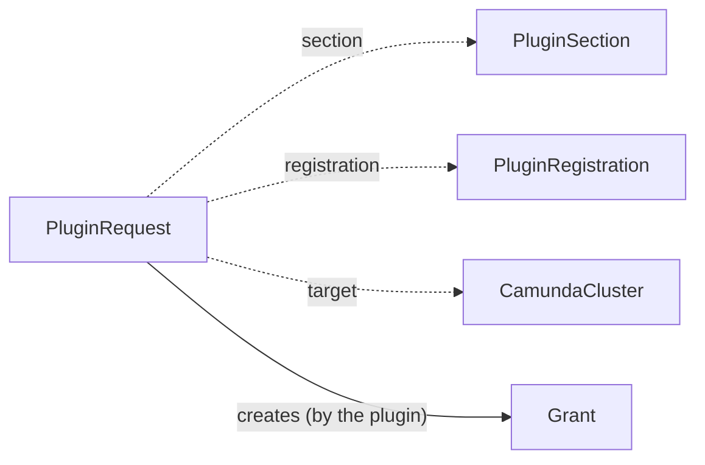

# PluginRequest

A `PluginRequest` asks a plugin for the resources of one section of a claim. A claim writes one request for each option that it selects, for example the request `orders-backup-storage` of the claim `orders`. The plugin that serves the [PluginRegistration](pluginregistration.md) of the option writes the status: its outputs, its health, and the resources that it made.

`PluginRequest` is namespaced. It lives in the namespace of its claim. It is an alpha API in the group `plugins.camunda.io/v1alpha1`, and its fields can change in a later release.

The smallest request:

```yaml
apiVersion: plugins.camunda.io/v1alpha1
kind: PluginRequest
metadata:
  name: orders-backup-storage
  namespace: my-cluster-ns
spec:
  section: backup-storage
  registration: s3-backup-bucket
  claimRef:
    kind: CamundaClusterClaim
    name: orders
  target:
    kind: CamundaCluster
    name: orders
  deletionPolicy: Delete
```



## Labels

Each request carries three labels that you can select on:

| Label | Value |
| --- | --- |
| `plugins.camunda.io/section` | The name of the section. |
| `plugins.camunda.io/registration` | The name of the registration. |
| `fleet.camunda.io/claim` | The name of the claim. |

To list the requests of one claim:

```bash
kubectl get pluginrequests -n my-cluster-ns -l fleet.camunda.io/claim=orders
```

Each resource that a plugin writes for a request carries the labels `plugins.camunda.io/registration` and `plugins.camunda.io/request`.

## Outputs

`status.outputs` holds the values that the plugin publishes for the request, by output key. Read them only when the condition `OutputsReady` is `True` and its `observedGeneration` equals `metadata.generation`. Before that, the outputs can belong to an older spec.

## Deletion

`spec.deletionPolicy` says what the plugin does with the resources of the request when the request is deleted:

- `Delete`: the plugin deletes the resources that it wrote for the request.
- `Orphan`: the plugin keeps the resources. A namespaced resource loses its owner reference to the request and keeps its labels. `status.resources[].onOrphan` says, for each resource, whether it is `Kept` or `Deleted` with this policy.

With both policies, the plugin deletes a route to a Service that no longer exists. The request goes away only after the plugin applies the policy. The claim copies its own deletion policy to the request before it deletes the request.

## Status

| Type | Reason | Meaning | What to do |
| --- | --- | --- | --- |
| `OutputsReady` | set by the plugin | `True` when the plugin wrote the outputs for the current generation. | If it stays `False`, read the message and the events of the request. |
| `Ready` | `Healthy` | The resources of the request are ready. | Nothing. |
| `Ready` | `GrantRejected` | A `Grant` of the request is not `Ready`. The outputs stay usable. | Read the status of the grant. See [Grant](grant.md#status). |
| `Ready` | `WaitingForEndpoints` | An access request waits for the endpoints in the status of its target. | Wait for the target to report its endpoints. |
| `Ready` | `InvalidParameters` | The parameters do not pass the schema or the rules of the registration. | Correct the parameters in the claim. |
| `Ready` | set by the plugin | Another state of the plugin. | Read the message, and the logs of the plugin controller. |

The plugin records an event on the request for each external action, for example a bucket that it created.

The rest of the status is for display:

```yaml
status:
  observedGeneration: 1
  conditions:
    - type: OutputsReady
      status: "True"
      reason: Healthy
      observedGeneration: 1
    - type: Ready
      status: "True"
      reason: Healthy
      observedGeneration: 1
  outputs:
    objectStorageConfig: orders-backup-storage
  summary:
    - label: Bucket
      value: orders-backup-storage
      severity: Info
  summaryTime: "2026-10-15T09:00:00Z"
  links:
    - name: Bucket console
      url: https://s3.console.aws.amazon.com/s3/buckets/orders-backup-storage
  podSelector:
    matchLabels:
      plugins.camunda.io/request: orders-backup-storage
  resources:
    - kind: S3Bucket
      name: orders-backup-storage
      id: arn:aws:s3:::orders-backup-storage
      location: eu-west-1
      role: Backup bucket
      onOrphan: Kept
```

`summary` lists facts about the request, and the first item is the headline. `severity` is `Info`, `Warning`, or `Error`. `links` are named URLs about the request. `podSelector` selects the pods that the plugin runs for the request. `resources` lists what the plugin made, in the cluster or in a cloud.

## Fields

The [API reference](api-reference.md#pluginrequest) lists every field of `PluginRequest`, with its type and its validation.

## Validation rules

The API server refuses a change of these fields after the request is created:

- `section`: `section is immutable: delete the request and create a new one`.
- `registration`: `registration is immutable: delete the request and create a new one`.
- `claimRef`: `claimRef is immutable: delete the request and create a new one`.
- `target.kind`: `target.kind is immutable: delete the request and create a new one`.
- `target.name`: `target.name is immutable: delete the request and create a new one`.

It also refuses a name longer than 63 characters: `metadata.name must be at most 63 characters, because it is used as a label value`.

## A request with inputs and parameters

The claim `orders` writes this request for the option `s3-backup-bucket`. It carries the key of the section `encryption-key` as the input `kmsKey`, and the retention that the claim selected:

```yaml
apiVersion: plugins.camunda.io/v1alpha1
kind: PluginRequest
metadata:
  name: orders-backup-storage
  namespace: my-cluster-ns
spec:
  section: backup-storage
  registration: s3-backup-bucket
  claimRef:
    kind: CamundaClusterClaim
    name: orders
  target:
    kind: CamundaCluster
    name: orders
    serviceAccountName: orders-camunda
    additionalServiceAccounts:
      - orders-es
  inputs:
    kmsKey: arn:aws:kms:eu-west-1:111122223333:key/example
  parameters:
    retentionDays: 30
  deletionPolicy: Delete
```

## Related

- [PluginRegistration](pluginregistration.md): the option that serves the request.
- [PluginSection](pluginsection.md): the section that the request fills.
- [Grant](grant.md): the permissions that the plugin asks for on behalf of the request.
- [API reference](api-reference.md#pluginrequest): every field of the kind.
