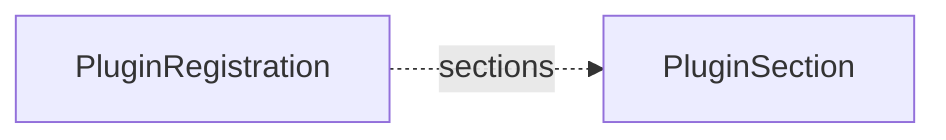

# PluginSection

A `PluginSection` is one step of the create flow of a claim in the fleet manager, for example "Backup storage" or "Access". The [PluginRegistrations](pluginregistration.md) that name the section are its options. The operator writes the core sections. A plugin chart writes a section that it brings.

`PluginSection` is cluster-scoped. It is an alpha API in the group `plugins.camunda.io/v1alpha1`, and its fields can change in a later release.

The smallest section:

```yaml
apiVersion: plugins.camunda.io/v1alpha1
kind: PluginSection
metadata:
  name: dns-zone
spec:
  label: DNS zone
  selection: One
  appliesTo:
    - CamundaClusterClaim
```



## Core sections

The operator writes eight core sections:

| Name | Label | Slot | Empty option | Claim kinds | Outputs |
| --- | --- | --- | --- | --- | --- |
| `cloud-identity` | Cloud identity | `workloadIdentity` | No cloud identity | `CamundaClusterClaim` | `principal`, `serviceAccountAnnotations` |
| `encryption-key` | Encryption key | none | No key | `CamundaClusterClaim` | `keyRef`, `format` |
| `volume-encryption` | Volume encryption | `volumeEncryption` | Unencrypted volumes | `CamundaClusterClaim` | `storageClassName` |
| `backup-storage` | Backup storage | `backupStorage` | No backups | `CamundaClusterClaim` | `objectStorageConfig` |
| `secondary-storage` | Secondary storage | `secondaryStorage` | none | `CamundaClusterClaim` | `secondaryStorageConfig` |
| `access` | Access | `externalAccess` | No access from outside | `CamundaClusterClaim`, `CamundaManagementClusterClaim` | `externalUrl`, `grpcHost`, `optimizeUrl`, `managementHost` |
| `connectors-permissions` | Connectors permissions | `connectorsIdentity` | No cloud permissions | `CamundaClusterClaim` | `principal`, `serviceAccountAnnotations` |
| `management-database` | Databases | `managementDatabases` | none | `CamundaManagementClusterClaim` | `keycloakDatabaseConfig`, `identityDatabaseConfig`, `webModelerDatabaseConfig` |

Every core section has `selection: One`. Their `order` values are 10 to 80, in steps of 10, in the order of the table. A plugin section with an `order` between two of these values goes between them in the create flow.

The operator writes the core sections each time the manager starts:

- A core section that you delete comes back at the next start.
- A field of a core section that you change goes back to its value at the next start.
- A field that the operator does not write stays, for example a label that you add to `metadata.labels`.
- The operator never deletes a section, also when a later release no longer writes it. A claim can still name it.

The operator writes these fields with the field manager `camunda-operator-builtins`. A GitOps tool that writes the same fields of a core section shows this name in its conflict message.

## Slots

A slot names the fields of the generated resource that the outputs of a section fill. The set of slots is closed. A section without a slot has outputs that only other registrations read as inputs, for example the key of `encryption-key`.

| Slot | Outputs | What the outputs fill |
| --- | --- | --- |
| `workloadIdentity` | `principal`, `serviceAccountAnnotations` | The ServiceAccount annotations of the `CamundaCluster`, from `serviceAccountAnnotations`. |
| `volumeEncryption` | `storageClassName` | The StorageClass of the Zeebe volumes. |
| `backupStorage` | `objectStorageConfig` | `spec.backupStorageRef` of the `CamundaCluster`. |
| `secondaryStorage` | `secondaryStorageConfig` | `spec.storageRef` of the `CamundaCluster`. |
| `externalAccess` | `externalUrl`, `grpcHost`, `optimizeUrl`, `managementHost` | The external URLs of the `CamundaCluster` and of its `CamundaOptimize`, or the host of the `CamundaManagementCluster`. |
| `managementDatabases` | `keycloakDatabaseConfig`, `identityDatabaseConfig`, `webModelerDatabaseConfig` | The database references of Keycloak, Management Identity, and Web Modeler in the `CamundaManagementCluster`. |
| `connectorsIdentity` | `principal`, `serviceAccountAnnotations` | The ServiceAccount annotations of the Connectors, from `serviceAccountAnnotations`. |

A slot fills one field, so a section with a slot must have `selection: One`.

## Status

`PluginSection` has no status.

## Spec reference

Every field, with its type, whether it is required, and its default:

```yaml
apiVersion: plugins.camunda.io/v1alpha1
kind: PluginSection
metadata:
  # string. Required. The name of the section. At most 63 characters.
  name: dns-zone
spec:
  # string. Required. The name of the section in the fleet manager.
  label: DNS zone
  # string. Optional. What the section is for.
  description: The DNS zone that holds the records of the cluster.
  # integer. Optional, default: 0. The position in the create flow. A lower value comes first.
  order: 65
  # One or Many. Required. How many options of the section one claim can select.
  selection: One
  # string. Optional. The label of the option that selects nothing. Without it, the section has no empty option.
  emptyOptionLabel: No DNS records
  # string. Optional. The slot that the outputs fill. See "Slots". This section has none.
  # slot: volumeEncryption
  # list of CamundaClusterClaim or CamundaManagementClusterClaim. Required. The claim kinds whose create flow shows the section.
  appliesTo:
    - CamundaClusterClaim
  # list. Optional. The outputs that every registration of the section writes.
  outputs:
      # string. Required. The key of the output. A letter, then letters and digits.
    - key: zoneId
      # string. Optional. What the value is.
      description: The ID of the DNS zone.
      # string. Optional. The format of the value, for example aws-kms-arn.
      # format: aws-route53-zone-id
```

The `label`, `description`, `order`, and `emptyOptionLabel` fields change only what the fleet manager shows.

### Validation rules

The API server refuses a section when:

- It has a slot and `selection` is not `One`: `a section with a slot must have selection One, because a slot fills one field`.
- `emptyOptionLabel` is longer than 64 characters: `emptyOptionLabel must be at most 64 characters`.
- `appliesTo` is empty: `appliesTo must list at least one claim kind`.
- The name is longer than 63 characters: `metadata.name must be at most 63 characters, because it is used as a label value`.
- `label` is empty, or two outputs have the same `key`.

### A section that a plugin brings

A DNS plugin adds a section without a slot. Its output is an input of other registrations, for example an option of `access` that writes the DNS records of the cluster:

```yaml
apiVersion: plugins.camunda.io/v1alpha1
kind: PluginSection
metadata:
  name: dns-zone
spec:
  label: DNS zone
  description: The DNS zone that holds the records of the cluster.
  order: 65
  selection: One
  emptyOptionLabel: No DNS records
  appliesTo:
    - CamundaClusterClaim
  outputs:
    - key: zoneId
      description: The ID of the DNS zone.
```

## Related

- [PluginRegistration](pluginregistration.md): the options of a section.
- [PluginRequest](pluginrequest.md): the request that a claim writes for the option that it selects.
- [API reference](api-reference.md#pluginsection): every field of the kind.
