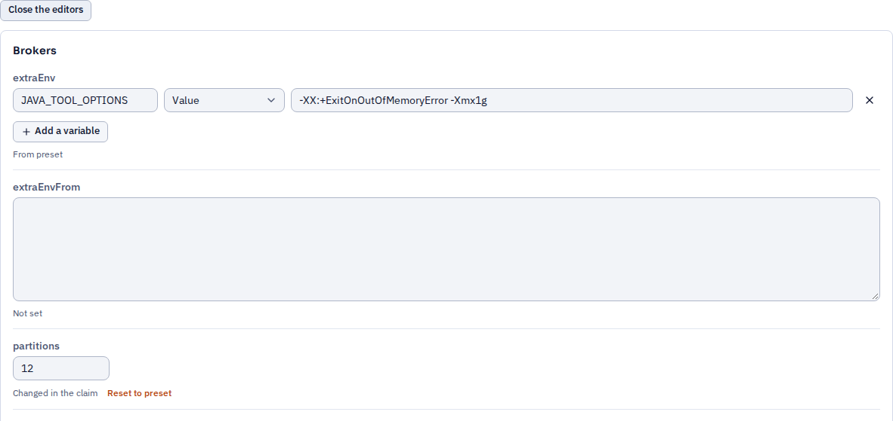
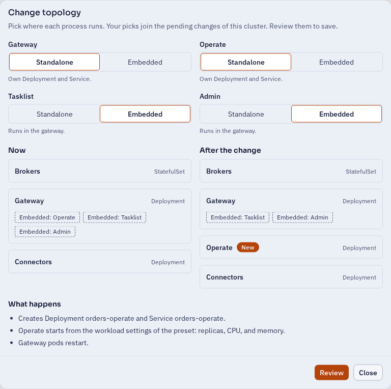
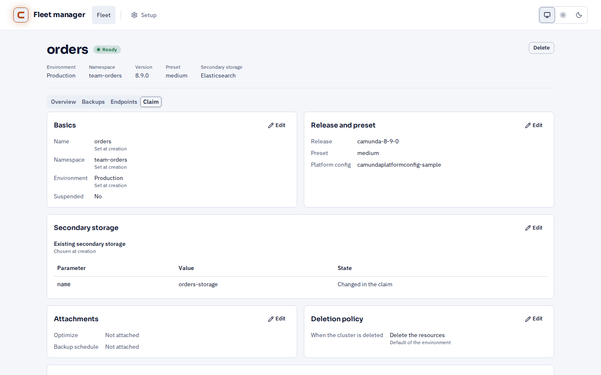

# Change a cluster
<!-- Screenshots: make fleet-docs-screenshots, scenarios claim-ready -->

You change a cluster on its [cluster page](cluster-page.md). Each change goes into the [claim](install.md#what-the-fleet-manager-writes) of the cluster, and the operator then changes the cluster. A cluster that shows **Not managed** has no editors.

Your changes collect as unsaved changes until you save them, as [Save or discard the changes](#save-or-discard-the-changes) shows.

## Change the settings of a component

1. Open the cluster page, and select the card of a component on the **Overview** tab, for example **Brokers**.
2. Open the **Settings** tab. It shows each setting with its value and where the value comes from.
3. Select **Edit settings**.
4. Change the values.

Each editor fits its setting. For example, `replicas` is a number, `resources` is a request and a limit, and `podLabels` has one row for each key. A list such as `scheduling.nodeAffinity` is YAML, checked against the schema of the field. **From a Secret** lists the Secrets of the namespace by name, never their values.



### Where a value comes from

Below each editor, the page says where the value comes from, for example **From preset** or **Changed in the claim**. **Reset to preset** removes your value, so the value of the preset applies again.

Some settings show their value and a reason, with no editor:

| Reason | What to change |
| --- | --- |
| Filled by *choice*, for example **Filled by Volume encryption** | The option of that choice sets the value. Change the parameters of the option on the **Claim** tab. |
| Set by the release | Pick another release. |
| Fixed by the claim controller | The operator sets the value. You cannot change it. |

### What a change writes

A change writes the setting in `spec.cluster` of the claim. The settings of Optimize go into `spec.attachments.optimize`. When you set `replicas` of Tasklist to 2, the claim gets:

```yaml
apiVersion: fleet.camunda.io/v1alpha1
kind: CamundaClusterClaim
metadata:
  name: my-cluster
  namespace: my-cluster-ns
spec:
  cluster:
    tasklist:
      replicas: 2
  # ... the rest of your claim
```

A setting that you leave as it is stays out of the claim, so the preset decides it. One exception is a block such as `scheduling`: a change of one part writes the whole block into the claim. The other parts keep their values, but they no longer follow the preset.

A volume cannot become smaller. A smaller `storageSize` keeps the current size of the volumes.

### Embedded apps

Operate, Tasklist, and Admin run inside the gateway unless their `mode` is `Standalone`. Their settings, such as Tasklist `replicas`, apply only when they run standalone, except `extraEnv` and `extraEnvFrom`.

## Change the topology

The **Topology** panel on the **Overview** tab shows where each process runs. **Change topology** opens a choice for the gateway, Operate, Tasklist, and Admin:

- **Standalone**: the process gets its own Deployment and Service.
- **Embedded**: the gateway runs in the brokers. Operate, Tasklist, and Admin run in the gateway, or in the brokers when the gateway is embedded too.

The dialog shows the topology **Now** and **After the change**. The list **What happens** names what the change creates, removes, and restarts. When Operate of `my-cluster` becomes standalone, the list is:

- Creates Deployment my-cluster-operate and Service my-cluster-operate.
- Operate starts from the workload settings of the preset: replicas, CPU, and memory.
- Gateway pods restart.

The number of brokers and partitions is on the **Settings** tab of the brokers, not in this dialog.



### A running backup

A change that restarts the brokers can make a running backup fail. A change of the Camunda version or of the gateway mode restarts the brokers. The review then warns, and the save button reads **Change anyway**, or **Push anyway** in Git mode:

> CAUTION: Wait until backup my-cluster-manual-1 finishes. This change can restart the brokers, which can fail a running backup.

## Change the claim in the Claim tab

The **Claim** tab shows the choices for the whole cluster in panels. Select **Edit** on a panel, make the change, and select **Done**.

**Basics** shows the name, the namespace, and the environment. You cannot change them. **Suspend the cluster** stops every workload of the cluster and keeps the volumes.

**Release and preset** has three lists:

- **Release** lists the releases that the environment allows, newest first.
- **Preset** lists the presets that the environment allows. The review shows each setting that the new preset changes.
- **Platform config** lists the platform configs. **Default of the environment** uses the one of the environment.

The **Release** list marks a release that you cannot move to yet:

| The list shows | What it means |
| --- | --- |
| Skips 8.*n*. Move to an 8.*n* release first. | The release is more than one minor ahead. Move to a release of the minor between them first. |
| downgrade | The release has a lower version. The review asks you to confirm the downgrade. |

After a downgrade, the panel offers **Clear** to remove the downgrade approval from the claim. [Downgrade on purpose](../crds/camundacluster.md#downgrade-on-purpose) tells when a downgrade is safe.

Each storage and access option has its own panel. You cannot change the option after creation. You can change each parameter that the environment lets a cluster change.

**Attachments** has two parts:

- **Attach Optimize** adds Optimize. Pick the **ManagementAuthConfig**, and enter the **External URL** when no access option fills it. **Open Optimize** opens its page, where its **Settings** tab holds its other settings.
- **Back up on a schedule** adds a schedule with the cron `0 2 * * *`. You can change the **Schedule (cron, UTC)**, **Completed backups to keep**, and **Failed backups to keep**.

**Deletion policy** says if the resources of the storage and access options stay when the cluster is deleted: **Keep the resources** or **Delete the resources**. When an option always deletes what it made, the panel shows it with **Always deleted**, and **Keep the resources** is off.



## Save or discard the changes

The bar at the bottom of the page counts your unsaved changes:

1. Select **Review** to see the change of the claim and what it does.
2. Select **Save**. In Git mode, the button is **Push to Git**.

**Discard** removes every unsaved change.

While an editor shows an error, **Review** is off, and the bar names the setting and the error. Correct the value, or reset it. The most common error is a CPU or memory limit below its request, as [Errors in the settings](create-a-cluster.md#errors-in-the-settings) shows.

If another tool, such as `kubectl apply`, set a field that your change touches, the review asks before it takes the field over. [Fields that another tool set](settings.md#fields-that-another-tool-set) says what that means.
