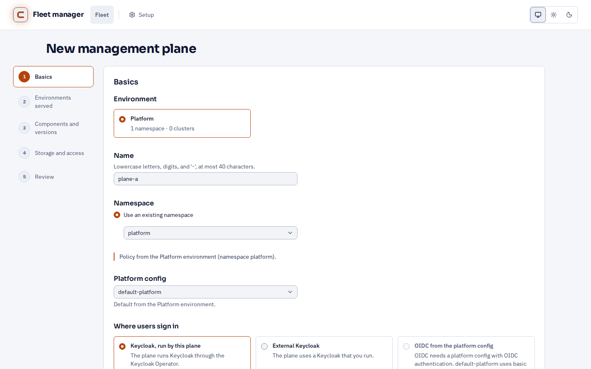
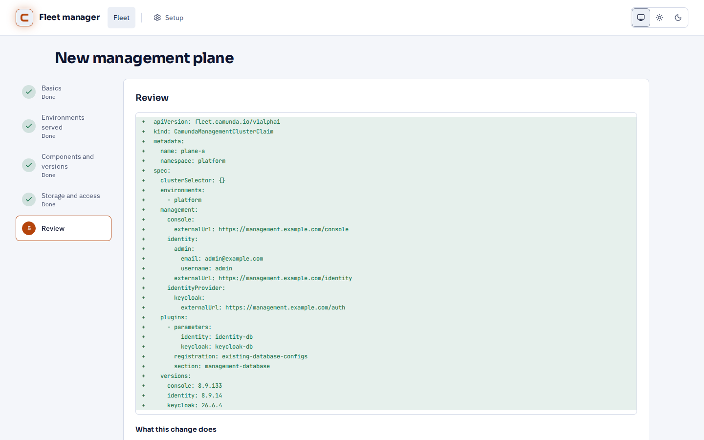
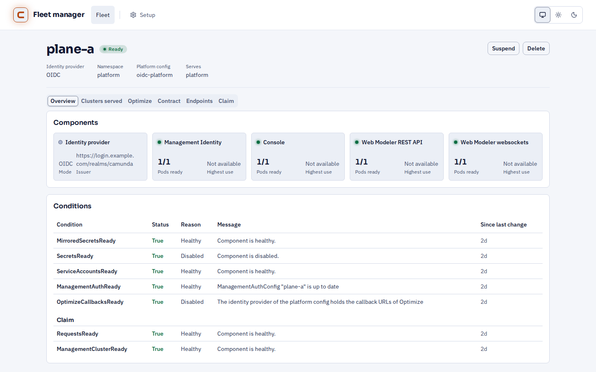

# Management planes
<!-- Screenshots: make fleet-docs-screenshots, scenarios plane-create, plane-ready -->

A management plane runs Management Identity, Console, and Web Modeler for the clusters of one or more environments. The fleet manager writes a claim for the plane, a [CamundaManagementClusterClaim](../crds/camundamanagementclusterclaim.md), and the operator builds the plane from it. [What the fleet manager writes](install.md#what-the-fleet-manager-writes) explains claims.

## Create a management plane

Open **Management planes** at `/fleet/planes` and select **New management plane**. The form has five steps. As in the cluster form, **Next** stays off while a step has an error, and the errors show at the bottom of the form.

### Basics

Pick the environment, the name, and the namespace of the plane. The **Platform config** starts at the one of the environment.

**Where users sign in** has three options:

- **Keycloak, run by this plane**: the plane runs Keycloak through the Keycloak Operator.
- **External Keycloak**: the plane uses a Keycloak that you run. Enter its URL, the realm, and the Secret with the administrator credentials.
- **OIDC from the platform config**: users sign in at the OIDC provider of the platform config. This option is off while the platform config uses basic authentication.



### Environments served

The plane serves the clusters of the environments that you select. **Cluster labels** narrow the clusters. Leave them empty to serve every cluster in these environments. **Expected clusters** shows what each cluster can expect.

### Components and versions

Management Identity always runs. Enter its first administrator:

- With Keycloak, enter a **Username** and an **Email**. Without a **Password Secret**, the operator generates a password.
- With OIDC, enter the **Claim name** and the **Claim value** of the token claim that identifies the administrator. An example is `sub` and the ID of the user.

Management Identity reads the first administrator once, at its first start.

Select **Run Console** and **Run Web Modeler** to run them. Web Modeler sends mail, so it needs an SMTP server. Enter the host, the port, and the sender address. If the server needs a sign-in, pick a **Credentials Secret** with the keys `username` and `password`.

The step fills one version for each component, for the Camunda minor of the default release of the first environment that the plane serves. You can type another version. Management Identity, Console, and Web Modeler need `8.9.0` or later. Keycloak needs a version from `26.0.0`, below `27.0.0`. Management Identity 8.9 cannot create its realm in Keycloak `26.7.0` or later, and the step shows a warning. [The operator runs Keycloak](../crds/camundamanagementcluster.md#the-operator-runs-keycloak) gives the reason.

### Storage and access

**Databases** offers the database options that the environment allows:

- **New PostgreSQL server** creates one database server for the plane, with a database for each component.
- **Existing databases** uses a `DatabaseConfig` of the namespace for each component. Two components cannot use the same one.

**Access** offers the access options that the environment allows, and **No access from outside**. An access option gives the plane one host, for example `my-plane.my-plane-ns.example.com`. Each component serves under its own path on that host:

| Component | Path |
| --- | --- |
| Keycloak | `/auth` |
| Management Identity | `/identity` |
| Console | `/console` |
| Web Modeler | `/modeler` |
| Web Modeler websockets | `/modeler-ws` |

With **No access from outside**, enter the URL where browsers reach each component. The Keycloak URL must have the path `/auth`.

**When the management plane is deleted** says what happens to the resources of these options: **Keep the resources** or **Delete the resources**.

**Contract name** is the name of the [ManagementAuthConfig](../crds/managementauthconfig.md) that the plane writes for Optimize. Leave it empty to use the name of the plane.

### Review

The review shows the claim as YAML and what it creates:

```yaml
apiVersion: fleet.camunda.io/v1alpha1
kind: CamundaManagementClusterClaim
metadata:
  name: my-plane
  namespace: my-plane-ns
spec:
  clusterSelector: {}
  environments:
    - production
  management:
    console:
      externalUrl: https://plane.example.com/console
    identity:
      admin:
        email: admin@example.com
        username: admin
      externalUrl: https://plane.example.com/identity
    identityProvider:
      keycloak:
        externalUrl: https://plane.example.com/auth
  plugins:
    - parameters:
        identity: my-identity-db
        keycloak: my-keycloak-db
      registration: existing-database-configs
      section: management-database
  versions:
    console: 8.9.130
    identity: 8.9.12
    keycloak: 26.6.4
```

Select **Create**, or **Push to Git** in Git mode.



### Progress

After **Create**, the page shows one row for each part of the plane: **Environment and policy**, **Databases**, **Access**, and **Management cluster**. If the operator refuses the claim, the page shows the reason and the message:

```yaml
status:
  environment: production
  conditions:
    - type: Ready
      status: "False"
      reason: MissingInput
      message: without an access selection, the claim must set spec.management.console.externalUrl
      observedGeneration: 1
```

The [Status](../crds/camundamanagementclusterclaim.md#status) section of `CamundaManagementClusterClaim` lists each reason and what to do.

## Read the state of a management plane

Select the name of a plane at `/fleet/planes`. The header shows the `Ready` condition, the identity provider, the namespace, the platform config, and the environments that the plane serves.

| Tab | What it shows |
| --- | --- |
| **Overview** | A card for each component, with its state, its ready pods, and its CPU or memory use. Then the **Conditions** of the plane. |
| **Clusters served** | Each cluster that the plane selects, and if the plane serves it. A row that is not attached gives the reason. |
| **Optimize** | Each Optimize that signs in through the plane, with its callback URL. |
| **Contract** | The `ManagementAuthConfig` that Optimize reads: the URLs of Management Identity, the client ID, and the audience. |
| **Endpoints** | The routes of the plane, with the public URL of each. |
| **Claim** | The choices of the plane, as [Change a management plane](#change-a-management-plane) shows. |

In OIDC mode, the plane registers no Optimize callback. The **Optimize** tab then says `Add the callbacks to your identity provider.` Add each callback URL of the tab to the Optimize application of your identity provider.

In OIDC mode, `KeycloakReady`, `SecretsReady`, and `OptimizeCallbacksReady` show `True` with the reason `Disabled`. This is expected, and it does not hold `Ready` back. The [Status](../crds/camundamanagementcluster.md#status) section of `CamundaManagementCluster` lists each reason and what to do.



### Planes without a claim

A plane without a claim shows `Not managed by the fleet manager. You can read this management plane but not change it here.` Change such a plane where you manage it, for example in your GitOps repository.

## Change a management plane

The **Claim** tab shows the choices of the plane. Select **Edit** on a part to change it. These values stay as they were at creation: the name, the namespace, and the database and access options. In OIDC mode, the first administrator is also fixed after Management Identity started.

| Change | What happens |
| --- | --- |
| Another platform config | Management Identity, Console, and Web Modeler restart. In OIDC mode, add the Optimize callbacks to the new identity provider. |
| Another sign-in option | Enter the first administrator of the new option. The old administrator stays in Management Identity, so a new username makes a second user. |
| Other environments or cluster labels | The page lists each cluster that the change attaches or detaches. With Console, each such cluster restarts once. |
| Console off | The served clusters lose their Console settings and restart once. |
| Web Modeler off | The database of Web Modeler stays. Each served cluster with basic authentication loses the Web Modeler user of the plane. |
| Other versions | The page warns when a version goes down or skips a minor, or when the apps run on different minors. |

The bar at the bottom of the page counts your changes. **Review** shows the change and the apps that restart. A change of where users sign in asks you to type the name of the plane before **Save**. In Git mode, the button is **Push to Git**.

If another tool set a field that your change touches, the review asks before it takes the field over. [Fields that another tool set](settings.md#fields-that-another-tool-set) says what that means.

## Suspend a management plane

Suspend stops the plane and keeps its data. The served clusters keep running, but sign-in to Console, Web Modeler, and Optimize stops for them.

1. Select **Suspend** in the header. The page says what stops.
2. Select **Suspend the management plane**.

The page sets `spec.suspend: true` on the claim:

```yaml
apiVersion: fleet.camunda.io/v1alpha1
kind: CamundaManagementClusterClaim
metadata:
  name: plane-a
  namespace: platform
spec:
  suspend: true
  # ... the rest of your claim
```

When every workload is at zero, the header shows `Ready · Suspended`. Select **Resume** to start the plane again.

!!! warning "A cluster that signs in through the Keycloak of the plane"
    With **Keycloak, run by this plane**, a cluster can use that Keycloak as its OIDC issuer. Its users and API clients cannot sign in or get tokens while the plane is suspended or deleted.

## Delete a management plane

1. Select **Delete** in the header of the plane.
2. Choose **Keep the resources** or **Delete the resources** for the database and access options.
3. Read what the delete takes. The served clusters keep running, but they lose their Console settings and sign-in through the plane, and restart once. Each Optimize that reads the contract of the plane reports `InvalidReference`.
4. Type the name of the plane.
5. Select **Delete the management plane**. In Git mode, the button is **Push the delete to Git**.

With **Delete the resources**, a deleted database server erases its data. A deleted `Database` keeps its data on its server. The page names both cases before you confirm.

The [Deletion](../crds/camundamanagementclusterclaim.md#deletion) section of `CamundaManagementClusterClaim` describes the delete. In Git mode, the delete works as for a cluster, as [Delete in Git mode](cluster-page.md#delete-in-git-mode) shows.
