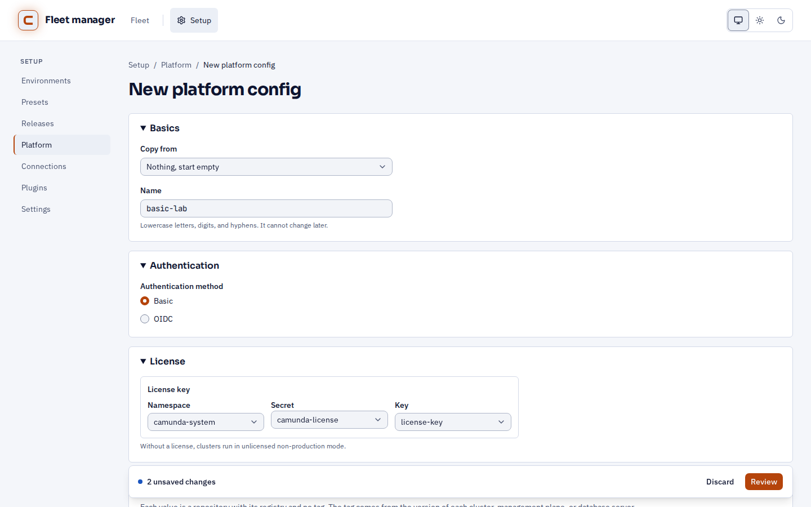
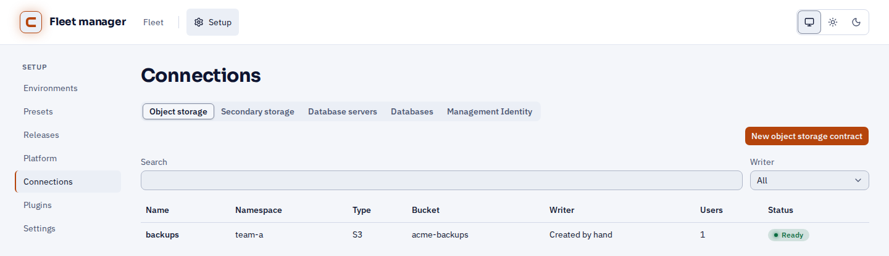
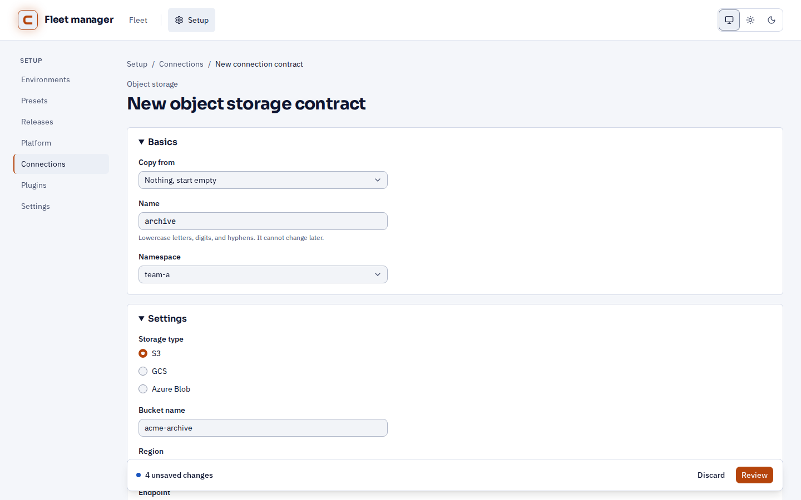

# Platform config and connections
<!-- Screenshots: make fleet-docs-screenshots, scenarios claim-ready, cluster-es-backups -->

## Platform config

A platform config holds the authentication, the license, and the image repositories of the clusters, management planes, and database servers that use it. The page **Setup > Platform** lists each `CamundaPlatformConfig` with its authentication method, its users, and its status. The [CamundaPlatformConfig](../crds/camundaplatformconfig.md) reference lists the fields.

You can also apply a platform config with `kubectl apply` or your GitOps tool:

```yaml
apiVersion: core.camunda.io/v1
kind: CamundaPlatformConfig
metadata:
  name: camundaplatformconfig-sample
spec:
  auth:
    method: oidc
    oidc:
      issuerUrl: "https://login.example.com/realms/camunda"
      clientId: "camunda-orchestration"
      audience: "camunda-orchestration"
      clientSecretRef:
        name: "oidc-credentials"
        namespace: "camunda-system"
        key: "client-secret"
  licenseSecretRef:
    name: "camunda-license"
    namespace: "camunda-system"
    key: "license-key"
  images:
    camunda: "registry.example.com/camunda/camunda"
    optimize: "registry.example.com/camunda/optimize"
```

**Used by** on the page of a platform config lists each cluster, management plane, database server, and environment that uses it.

### Create a platform config

Select **New platform config** on the page **Setup > Platform**. Type the **Name**. Clusters, management planes, database servers, claims, and environments use this name to refer to the config. You cannot change it later. To start from a config that exists, select it in **Copy from**. The new config then gets the authentication, the license Secret, and the image repositories of that config.

Select the authentication method. Then complete the fields, the license Secret, and the image repositories, as on the page of a config. Select **Review**, then **Create**, or **Push to Git** in Git mode. The page of the new config opens.



A Secret that does not exist shows as `(not found)`. You can create the config anyway, but it is not ready until the Secret exists.

### Change a platform config

The page edits the authentication method, the OIDC fields, the clients of the management plane, the license Secret, and the image repositories. A note above the form says what a change does:

`A change rolls the pods of every cluster and management plane that uses this config, and of the Optimize of each such cluster. A database server changes only when the postgres image changes.`

Each Secret reference names a namespace, a Secret, and a key. The page shows the names only, never a value.

When you change a field, the bar at the bottom of the page offers **Review**. Select **Save**, or **Push to Git** in Git mode.

When a Secret or a key that the platform config names does not exist, the platform config is not ready. The page shows the message:

```yaml
status:
  conditions:
  - type: Ready
    status: "False"
    reason: MissingSecret
    message: "spec.licenseSecretRef: Secret camunda-system/camunda-license not found"
```

Create the Secret with the key, or pick another one.

### Image repositories

The part **Image repositories** shows the default repository under each field. A field that you leave empty uses the default. The page shows repositories only. The tag always comes from the version that the cluster, plane, or database server runs.

### Delete a platform config

The page offers the delete only when nothing uses the platform config. Type its name, select **Review the delete**, then select **Delete the platform config**. In Git mode, the button is **Push the delete to Git**.

## Connections

A connection contract tells a cluster where its storage or its identity provider is, for example a bucket or an Elasticsearch address. See [Contracts](../crds/index.md#contracts). The page **Setup > Connections** lists the contracts of every namespace, with who wrote each one, what uses it, and its status. It shows the names and the keys of Secrets, never a value.

| Tab | Kind | What the contract holds |
| --- | --- | --- |
| **Object storage** | [ObjectStorageConfig](../crds/objectstorageconfig.md) | A bucket for backups, documents, Elasticsearch snapshots, or the archive of a PostgreSQL server. |
| **Secondary storage** | [SecondaryStorageConfig](../crds/secondarystorageconfig.md) | The Elasticsearch or the relational database that a cluster writes its data to. |
| **Database servers** | [DatabaseServerConfig](../crds/databaseserverconfig.md) | A PostgreSQL server and its admin credentials. |
| **Databases** | [DatabaseConfig](../crds/databaseconfig.md) | One database on a database server, with its credentials. |
| **Management Identity** | [ManagementAuthConfig](../crds/managementauthconfig.md) | How Optimize signs in to the Management Identity of a management plane. |

Select the name of a contract to open its page, with the panels **Status**, **Writer**, **Settings**, and **Used by**.



### Who wrote a contract

The column **Writer** says who wrote the contract:

| Writer | Meaning |
| --- | --- |
| `Registration <registration>` | A storage or access option of a cluster or plane wrote it. |
| `Management plane <namespace>/<plane>` | A management plane wrote it. |
| `<Kind> <name>` | The object that owns it, for example `ElasticsearchCluster orders-es`. |
| `Kept from <registration>` | An option wrote it, and its cluster was deleted with **Keep the resources**. |
| `Created by hand` | You created it on this page, or you or a tool applied it. |

You can change and delete only a contract that is `Created by hand` or `Kept from <registration>`. Any other contract shows `Managed by <writer>. Change it there.`

### Who uses a contract

**Used by** lists each object that uses the contract, with its own status. These are clusters, Optimize, management planes, database servers, Elasticsearch clusters, and backups and restores that still need the contract. A backup counts, because a restore reads from its bucket.

### Create a contract

Open the tab of the kind, and select its **New** button, for example **New object storage contract**. Type the **Name**. Clusters and other resources use this name to refer to the contract. You cannot change it later.

Select the **Namespace**. Only resources in that namespace can use the contract. A Management Identity contract has no namespace. To start from a contract of the same kind, select it in **Copy from**. The new contract gets its settings.

For a storage contract, select the storage type. For an object storage contract, also select the auth type. Then complete the fields and the Secrets, as in [Change a contract](#change-a-contract). Select **Review**, then **Create**, or **Push to Git** in Git mode. The page of the new contract opens, with the writer `Created by hand`.



The page refuses a name that a contract of the same kind has in the namespace. It also refuses a Management Identity name that a management plane uses.

### Change a contract

On the page of a contract that you can change, **Settings** is a form. You can change, for example, a bucket, a region, an endpoint, the credentials, or the host and port of a server. To change the storage type or the auth type, apply the contract again with `kubectl` or your GitOps tool.

**Review** names each user of the contract and what it does after the save, for example:

`CamundaCluster my-cluster-ns/my-cluster restarts its pods, all but Connectors.`

A cluster, its Optimize, and a management plane restart their pods when a contract that they use changes. A running backup fails when the location of its bucket changes. Select **Save**, or **Push to Git** in Git mode.

### Delete a contract

The page offers the delete only when nothing uses the contract. Type its name, select **Review the delete**, then select **Delete the contract**. In Git mode, the button is **Push the delete to Git**.

### Status

The panel **Status** shows the `Ready` condition of the contract, which the operator writes. The reference page of each kind lists the reasons.

Each user in **Used by** shows its own `Ready`. One cluster holds one secondary storage at a time. A second cluster on the same contract shows the reason `StorageAlreadyAttached` and stays suspended. [A second cluster on a held backend](../crds/camundacluster.md#a-second-cluster-on-a-held-backend) tells you what to do.
