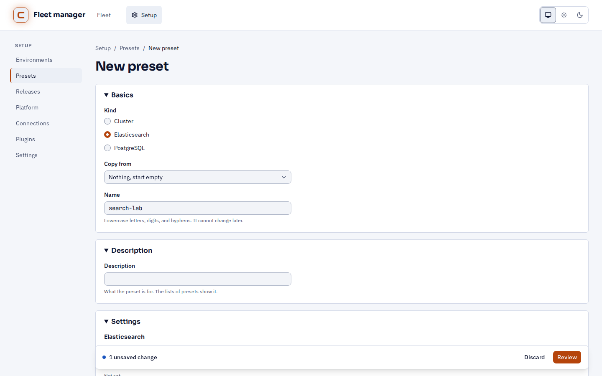
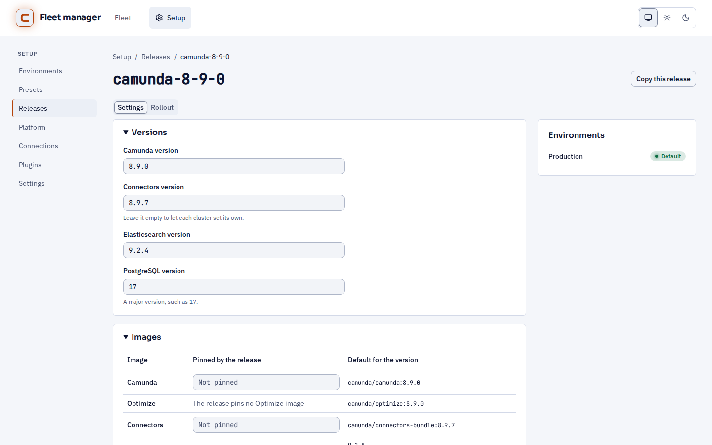
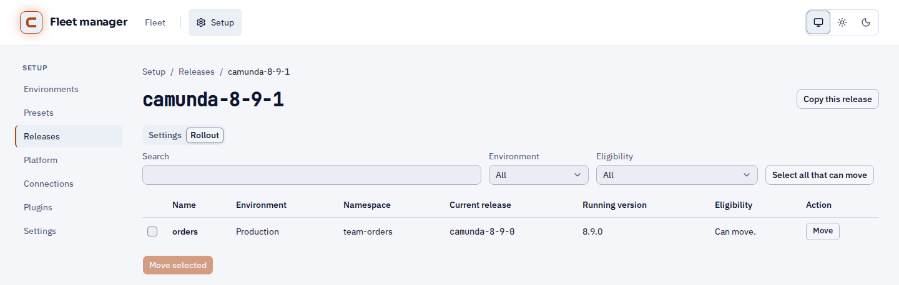

# Presets and releases
<!-- Screenshots: make fleet-docs-screenshots, scenarios claim-ready, release-rollout -->

A preset holds the shared settings of the clusters that use it, such as the number of brokers, the CPU, and the memory. A release says what a cluster runs: the versions, the pinned images, and the environment variables. The pages **Setup > Presets** and **Setup > Releases** show and edit them.

## Presets

The page **Setup > Presets** lists the presets of three kinds:

| Kind on the page | Preset | Used by |
| --- | --- | --- |
| Cluster | [CamundaClusterPreset](../crds/camundaclusterpreset.md) | Camunda clusters |
| Elasticsearch | [ElasticsearchClusterPreset](../crds/elasticsearchclusterpreset.md) | The option **New Elasticsearch cluster** |
| PostgreSQL | [DatabaseServerPreset](../crds/databaseserverpreset.md) | The option **New PostgreSQL server** |

Each row shows the key facts of the preset, the environments that allow it in **Allowed in**, and its users in **Used by**. You can also apply a preset with `kubectl` or through your Git repository.

The description of a preset comes from its annotation `kubernetes.io/description`. The create form shows it on the card of the preset:

```yaml
apiVersion: core.camunda.io/v1
kind: CamundaClusterPreset
metadata:
  name: medium
  annotations:
    kubernetes.io/description: "For production workloads with three brokers and replication."
spec:
  # ... the rest of your preset
```

### Create a preset

Select **New preset** on the page **Setup > Presets**. Pick the **Kind**: **Cluster**, **Elasticsearch**, or **PostgreSQL**. **Copy from** lists the presets of that kind. Pick one to start from its fields, or keep **Nothing, start empty**. Type the **Name**. Resources name the preset by it, and it cannot change later.

Set the fields as on the page of a preset. Select **Review**, then **Create**, or **Push to Git** in Git mode. The page of the new preset opens.



An environment allows a new preset only when it lists the name of the preset already. To offer the preset to new clusters, allow it on the [Environments](environments.md) page.

### Change a preset

1. Select the preset in the list to open its page.
2. Change the fields. For example, go to the group **Brokers** in **Settings** and type the new value in `replicas`.
3. Select **Review** in the bar at the bottom of the page.
4. Read the diff and the clusters that the change reaches.
5. Select **Save**, or **Push to Git** in Git mode.

A field that the preset sets shows **From preset**. **Remove from the preset** takes the field out of the preset. An Elasticsearch preset and a PostgreSQL preset have one group, **Elasticsearch** or **PostgreSQL**, with each field that the preset can set.

The review lists each cluster that uses the preset, with one mark:

| Mark | Meaning |
| --- | --- |
| `Pods roll` | The workloads of the cluster restart. The brokers restart one at a time. |
| `Connectors restart` | Only the Connectors pods restart. |
| `No roll` | The cluster takes the change, but no pod restarts. |
| `Unchanged` | The change does not reach the cluster. |
| `Pods may roll` | The change reaches an Elasticsearch cluster or a database server, and its pods can restart. |

A change with the mark `Pods roll` rolls every cluster that uses the preset, also a cluster that sets the changed field itself. A smaller storage size does not shrink a volume.

A cluster that sets a field itself keeps its own value. Each field of the preset shows how the cluster value and the preset value join, for example **Merged by key** for labels. The merge rules of [CamundaClusterPreset](../crds/camundaclusterpreset.md#merge-rules), [ElasticsearchClusterPreset](../crds/elasticsearchclusterpreset.md#merge-rules), and [DatabaseServerPreset](../crds/databaseserverpreset.md#merge-rules) list the rules.

### Rotate the admin password

The page of a cluster preset has the part **Admin password**. Its button rotates the admin password of each cluster that uses the preset with basic authentication, for example **Rotate the admin password of 3 clusters**. A cluster that sets its own `auth.basic` does not count. The review names each cluster whose password changes. Select **Rotate**, or **Push to Git** in Git mode. A cluster that runs Connectors restarts its Connectors pods. See [Authentication: Rotate the password](../guides/authentication.md#rotate-the-password).

### Delete a preset

You can delete a preset only when no cluster uses it and no environment allows it.

1. Select the check box of each preset, or **Select all unused**.
2. Select the delete button under the table, for example **Delete 3 presets**.
3. Read the review, and select **Delete**.

In Git mode, the button of the review is **Push the delete to Git**. GitOps must prune the presets to delete them from the cluster.

## Releases

Clusters, Elasticsearch clusters, and database servers name a release. The page **Setup > Releases** lists the releases with their Camunda, Connectors, Elasticsearch, and PostgreSQL versions, and these facts:

| Fact | Meaning |
| --- | --- |
| `Unused` | Nothing names the release. |
| `Default in <environments>` | These environments give the release to a new cluster that names no release. |
| `Allowed in <environments>` | A cluster in these environments can use the release. |
| `Not offered to new clusters` | No environment allows the release. |

To offer a release to new clusters, allow it in an environment on the [Environments](environments.md) page. The [CamundaRelease](../crds/camundarelease.md) reference lists the fields.

### New release

Select **New release** on the list, or **Copy this release** on the page of a release. In **Copy from**, pick the release to copy. Type the **Release name**, change what differs, then select **Review** and **Create**.

### Release settings

The **Settings** tab of a release page edits the release:

```yaml
apiVersion: core.camunda.io/v1
kind: CamundaRelease
metadata:
  name: camunda-8-9-4
spec:
  version: "8.9.4"
  connectors:
    version: "8.9.7"
  elasticsearch:
    version: "9.2.8"
  databaseServer:
    version: "17"
  images:
    camunda: "mirror.example.com/camunda/camunda:8.9.4-patched"
  extraEnv:
    - name: CAMUNDA_SOME_NEW_FLAG
      value: "true"
```

- **Versions**: only **Camunda version** is required. **PostgreSQL version** takes a major version such as `17`.
- **Images**: a release can pin only the Camunda image and the Connectors image. Leave the field empty to use the default image for the version.
- **Environment variables**: one group for every workload, and one for each process. A variable takes a value, or a key of a Secret.

A change reaches every cluster, Elasticsearch cluster, and database server that uses the release, and their pods roll. A resource that sets its own version keeps it. The review names the users and each version that changes.



### Move clusters to a release

The **Rollout** tab of a release page lists every cluster with its current release, its running version, and if it can move:

| Eligibility | What to do |
| --- | --- |
| Can move | Select **Move**. |
| Not allowed in the environment | Allow the release in the environment of the cluster. |
| Downgrade | Select **Confirm downgrade**. |
| Skips a Camunda minor | Move to a release of the minor between them first. |
| A backup is pending or running | Wait until the backup ends. |
| Not managed by the fleet manager | Change the `CamundaCluster` itself. |
| Runs this release | Nothing. |
| Refused by the operator | Read the message on the row. |



To move many clusters, select their checkboxes, or **Select all that can move**, and then **Move selected**. The review shows each cluster and what the move does to it. A move restarts the cluster, and a built-in Elasticsearch cluster or database server of the cluster moves too. The move sets `spec.releaseRef` of each claim:

```yaml
apiVersion: fleet.camunda.io/v1alpha1
kind: CamundaClusterClaim
metadata:
  name: my-cluster
  namespace: my-cluster-ns
spec:
  releaseRef: camunda-8-9-1
  # ... the rest of your claim
```

A move of many clusters is one change, or one commit in Git mode. If the move stops at a cluster, the tab shows **The move did not finish**. It names each cluster that moved and each that did not.

**Confirm downgrade** moves one cluster at a time. It also sets `allowVersionDowngrade` to the version of the release. [Downgrade on purpose](../crds/camundacluster.md#downgrade-on-purpose) tells when a downgrade is safe.

### Delete a release

You can delete a release only when it is unused and no environment allows it. Select its checkbox, or **Select all that can be deleted**, then **Delete 1 release**, and confirm with **Delete**. In Git mode, GitOps must prune the release to delete it from the cluster.
