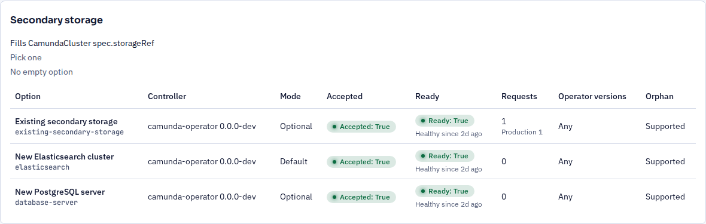
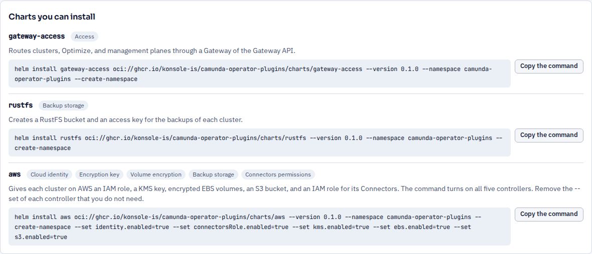

# Plugins
<!-- Screenshots: make fleet-docs-screenshots, scenarios claim-ready -->

The page **Setup > Plugins** lists the storage and access options of clusters and management planes, for example **Existing bucket** for **Backup storage**. An option is a [PluginRegistration](../crds/pluginregistration.md), also called a registration. The operator brings the built-in options, and each plugin, a Helm chart, adds more. The page also lists the official plugin charts that are not installed.

The page is read only. You install, upgrade, and remove a plugin chart with Helm. Each environment sets which options its clusters can use, on the [Environments](environments.md#storage-and-access-options) page.

## The list of options

The page has one group for each storage and access choice, such as **Backup storage**, in the order of the create form. The API calls such a choice a section. Above its options, each group says which field of the cluster the choice fills, and if a cluster picks one option or many. A choice without an installed option shows `No option is installed for this section.`

| Column | What it shows |
| --- | --- |
| Option | The label of the option, and its name. |
| Controller | The controller that serves the option, and its version. The built-in options show `camunda-operator`. |
| Mode | `Default`: a new cluster picks the option when no environment applies. `Optional`: a person picks it. |
| Accepted, Ready | The conditions of the option, as [Status of an option](#status-of-an-option) shows. |
| Requests | How many clusters and planes use the option. |
| Operator versions | The operator versions that the option supports, such as `>=0.3.0 <1.0.0`. `Any` means every version. |
| Orphan | `Supported` when the option can keep its resources after a delete. |

## Status of an option

`Accepted` says that the operator accepted the option. `Ready` says that the controller of the option is healthy. A cluster can pick an option only while both are `True`.

| Reason of `Accepted` | Meaning | What to do |
| --- | --- | --- |
| `SectionMissing` | The choice that the option serves does not exist. | Install the chart that brings the choice, or correct the section name of the option. |
| `OperatorVersionUnsupported` | The option does not support this version of the operator. | Install a version of the chart that supports this operator, or upgrade the operator. |
| `DefaultConflict` | Another option of the same choice also has the mode `Default`. | Set the mode `Optional` on all but one of them. |

A reason of `Ready` comes from the controller of the option. Read its message on the tab **Health**, and the logs of that controller.

## The page of an option

Select the label of an option to open its page. The page has six tabs:

| Tab | What it shows |
| --- | --- |
| **About** | The description, a link to its documentation, its controller, and the limits that its chart sets at install. |
| **Contract** | The choices that the option serves, the values that it takes from other options, and the values that it gives. |
| **Parameters** | Each parameter, with its default and the value of each environment. |
| **Grants** | The cloud permissions that the option asks for, as [Grants](cluster-page.md#grants) shows. |
| **Health** | The conditions and the events of the option. |
| **Used by** | Each cluster and plane that uses the option, with its state and the resources that the option made for it. |

A limit that the chart sets, for example a permissions boundary, cannot change in an environment or a cluster. Change the values of the chart and upgrade it with Helm.

## Install an official chart

The panel **Charts you can install** lists the official plugin charts that are not installed. A chart counts as installed when one of its options exists. Each chart shows what it does and the Helm command that installs it. Select **Copy the command**, then run the command with access to the cluster.

Keep the default controller name when you install a chart, or the panel still lists the chart as not installed.

