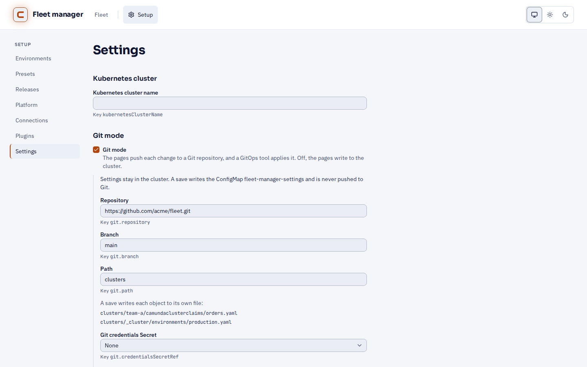
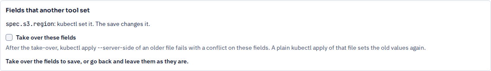

# Fleet manager settings
<!-- Screenshots: make fleet-docs-screenshots, scenarios claim-ready, cluster-es-backups -->

The settings of the fleet manager name this Kubernetes cluster, the Git repository for Git mode, and the Prometheus address. The fleet manager keeps them in the ConfigMap `fleet-manager-settings` in the release namespace, `camunda-operator-system` in the examples on this page.

The fleet manager works in one of two modes:

- Direct mode, the default: each save writes to the Kubernetes API.
- Git mode: each save is a commit in a Git repository, and your GitOps tool applies it. Git mode is on when `git.repository` is set.

## Set the settings at install

The chart values `fleetManager.settings.*` give the first value of each setting:

```bash
helm upgrade --install camunda-operator \
  oci://ghcr.io/konsole-is/charts/camunda-operator \
  --version <version> \
  --namespace camunda-operator-system \
  --create-namespace \
  --set fleetManager.enabled=true \
  --set fleetManager.settings.kubernetesClusterName=prod-eu \
  --set fleetManager.settings.prometheus.url=http://prometheus.monitoring:9090
```

The fleet manager creates the ConfigMap from these values the first time that it reads its settings. After that, a `helm upgrade` with other `fleetManager.settings.*` values does not change the ConfigMap. Use the Settings page or edit the ConfigMap instead.

## Settings

| Key in the ConfigMap | What it does |
| --- | --- |
| `kubernetesClusterName` | The name of this Kubernetes cluster. |
| `git.repository` | The HTTPS address of the Git repository. Turns on Git mode. |
| `git.branch` | The branch. Empty means the default branch of the repository. |
| `git.path` | The folder in the repository for the files of the fleet manager. Empty means the root. |
| `git.credentialsSecretRef` | The Secret with the Git credentials. See [Git credentials](#git-credentials). |
| `secretStore.kind`, `secretStore.name` | The External Secrets store for Secrets in Git mode. See [Secrets in Git mode](#secrets-in-git-mode). |
| `prometheus.url` | The address of Prometheus, for the charts and the backpressure warning. |
| `prometheus.credentialsSecretRef` | The Secret with the Prometheus credentials. See [Prometheus credentials](#prometheus-credentials). |

Each chart value has the same name under `fleetManager.settings`, for example `fleetManager.settings.git.repository`. Do not put a user name or a password in an address. The pages show the settings, so put the credentials in a Secret.

## Settings page

Open **Setup > Settings**. The page has a field for each setting, with its key in the ConfigMap under it. The page shows only the names of Secrets, never a value.

Select **Git mode** to show the Git settings. Clear it to turn Git mode off. The other Git settings stay for the next time.



**Test the connection** tests the Git repository, and **Test the query** tests Prometheus. Both use the saved settings, so save a change before you test it.

If someone changed the ConfigMap after you opened the page, **Save** writes nothing. Select **Reload**, then make your change again.

The page also shows if metrics-server is found, and the `kubectl port-forward` command that opens the fleet manager. It lists the permissions that the chart gives the fleet manager.

## Change a setting

Use the [Settings page](#settings-page), or edit the ConfigMap:

```bash
kubectl -n camunda-operator-system edit configmap fleet-manager-settings
```

A change takes effect without a restart. The fleet manager never commits the settings to Git.

## Fields that another tool set

Another tool, such as `kubectl apply` or a GitOps tool, can own a field of an object that you change in the fleet manager. In direct mode, the review before a save names each such field and the tool:

```text
Fields that another tool set
spec.displayName: kubectl-client-side-apply set it. The save changes it.
[ ] Take over these fields
```

Without **Take over these fields**, a changed field stops the save, and **Save** stays off. A field that the save removes stays on the object. Go back and leave the fields as they are, or take them over. With the take-over, the save writes your values, and the fields belong to the fleet manager from then on. The review asks again on each save.



After a take-over, the other tool can set its value again:

- `kubectl apply --server-side` of an older file fails with a conflict on each field. Remove the field from the file, or add `--force-conflicts`.
- A plain `kubectl apply` of the file sets the old values again, without a warning.
- Argo CD and Flux set their value again on the next sync. Change the source in Git too.

The review offers no take-over in Git mode, or for a field that the operator sets itself.

## Git credentials

The fleet manager connects to the repository over HTTPS. The Secret of `git.credentialsSecretRef` holds a token or the keys of a GitHub App, never both. Create it in the release namespace, then set `git.credentialsSecretRef` to its name. A change to the Secret takes effect without a restart.

### A token

```bash
kubectl -n camunda-operator-system create secret generic fleet-git \
  --from-literal=username=<user> \
  --from-literal=token=<token>
```

### A GitHub App

A GitHub App works for `github.com` and for GitHub Enterprise Server. For another Git server, use a token.

1. Create a GitHub App with the repository permission "Contents: Read and write", as [Registering a GitHub App](https://docs.github.com/en/apps/creating-github-apps/registering-a-github-app/registering-a-github-app) shows.
2. Install the App on the repository, as [Installing your own GitHub App](https://docs.github.com/en/apps/using-github-apps/installing-your-own-github-app) shows.
3. Write down the App ID from the settings page of the App.
4. Write down the installation ID. It is the number at the end of the address of the installation settings page.
5. Generate a private key for the App, and download the `.pem` file.
6. Create the Secret. For GitHub Enterprise Server, set `enterpriseHost` to the host of the server. For `github.com`, remove that line:

    ```bash
    kubectl -n camunda-operator-system create secret generic fleet-git \
      --from-literal=appId=<app id> \
      --from-literal=installationId=<installation id> \
      --from-literal=enterpriseHost=<host> \
      --from-file=privateKey=<app>.private-key.pem
    ```

The fleet manager must reach the GitHub API. Commits show the bot of the App as the author.

## Git mode

Set `git.repository` to turn on Git mode:

```yaml
apiVersion: v1
kind: ConfigMap
metadata:
  name: fleet-manager-settings
  namespace: camunda-operator-system
data:
  git.repository: https://git.example.com/platform/fleet.git
  git.branch: main
  git.path: clusters/prod
  git.credentialsSecretRef: fleet-git
  # ... the rest of your settings
```

The branch must exist before the first save. Each save becomes one commit on the branch. The fleet manager writes each object to its own file under `git.path`:

```text
clusters/prod/
├── _cluster/
│   └── namespaces/
│       └── team-a.yaml
└── team-a/
    └── camundaclusterclaims/
        └── orders.yaml
```

A namespaced object goes to `<git.path>/<namespace>/<plural>/<name>.yaml`, and a cluster-scoped object to `<git.path>/_cluster/<plural>/<name>.yaml`. A delete in the fleet manager removes the file. Point your GitOps tool at the folder of `git.path`.

Your GitOps tool must prune, so that it deletes the object of a removed file. Flux prunes when the Kustomization sets `prune: true`. Argo CD prunes when `syncPolicy.automated` sets `prune: true`.

Some changes go straight to the Kubernetes API, also in Git mode. These are backups, restores, the delete of a backup, and the environment label of a namespace. The settings stay in the ConfigMap.

### Waiting for GitOps

After a save in Git mode, each page shows "Waiting for GitOps to apply" at the top, with one line for each pushed file. A line goes away when your GitOps tool has applied the file. The list belongs to the browser tab, so a reload clears it. If a line stays, make sure that your GitOps tool syncs the folder of `git.path` and prunes.

### When a save fails

When the Kubernetes API or the Git server refuses a save, the save makes no commit and shows the message. The most common messages are:

| Message | What to do |
| --- | --- |
| `<file> in <repository> holds a save that GitOps has not applied yet. …` | Wait until GitOps applies the earlier save, then open the page again. If GitOps cannot apply it, correct or revert the file. |
| `<repository> refused the credentials.` | Correct the Secret of `git.credentialsSecretRef`. A GitHub App needs the permission "Contents: Read and write". |
| `<repository> refused the push to the branch <branch>.` | The branch is protected. Let the user of the token push, or use another branch. |
| `<repository> has no branch <branch>.` | Create the branch, or correct `git.branch`. |
| `<file> is not in the repository. GitOps does not manage <kind> <name>.` | Delete the object with `kubectl delete`. |

A message about the Secret names the key that is missing or wrong. Correct the Secret as [Git credentials](#git-credentials) shows.

## Prometheus credentials

The Secret of `prometheus.credentialsSecretRef` holds `username` and `password` for basic authentication, or `token` for a bearer token:

```bash
kubectl -n camunda-operator-system create secret generic fleet-prometheus \
  --from-literal=token=<token>
```

Then set `prometheus.credentialsSecretRef` to `fleet-prometheus`.

## Metrics of the charts

The **Metrics** tab of a component on [the cluster page](cluster-page.md) shows the live CPU and memory of each pod from metrics-server. Below them, it shows charts from Prometheus over the last hour, 6 hours, or 24 hours:

| Chart | Metric |
| --- | --- |
| CPU | `container_cpu_usage_seconds_total` |
| Memory | `container_memory_working_set_bytes` |
| Disk used | `kubelet_volume_stats_used_bytes` |
| Process instances activated | `zeebe_element_instance_events_total` |
| Records processed | `zeebe_stream_processor_records_total` |
| Records exported | `zeebe_exporter_events_total` |
| Requests dropped by backpressure | `zeebe_dropped_request_count_total` |
| Partition health | `zeebe_health` |

The first three come from the kubelet and cAdvisor, the others from the brokers. Prometheus must keep the labels `namespace` and `pod`, and `persistentvolumeclaim` on the disk metric. A `ServiceMonitor` or a `PodMonitor` of the Prometheus Operator adds these labels to the broker metrics. Camunda documents the broker metrics in [Camunda components metrics](https://docs.camunda.io/docs/self-managed/operational-guides/monitoring/metrics/#available-metrics).

The broker charts show for Camunda 8.9. For another version, the tab shows only CPU, Memory, and Disk used.

## Secrets in Git mode

In Git mode, the fleet manager never writes a Secret value to Git. It commits an `ExternalSecret`, and External Secrets makes the Secret from the store of `secretStore.kind` and `secretStore.name`. For the Secret `db` in the namespace `orders`:

```yaml
apiVersion: external-secrets.io/v1
kind: ExternalSecret
metadata:
  name: db
  namespace: orders
spec:
  refreshInterval: 1h
  secretStoreRef:
    kind: SecretStore
    name: vault
  target:
    name: db
    creationPolicy: Owner
  dataFrom:
    - extract:
        key: orders/db
```

Put each key of the Secret as a property of the store entry `<namespace>/<name>`, here `orders/db`. Without `secretStore.kind` and `secretStore.name`, the fleet manager refuses to write a Secret in Git mode.
